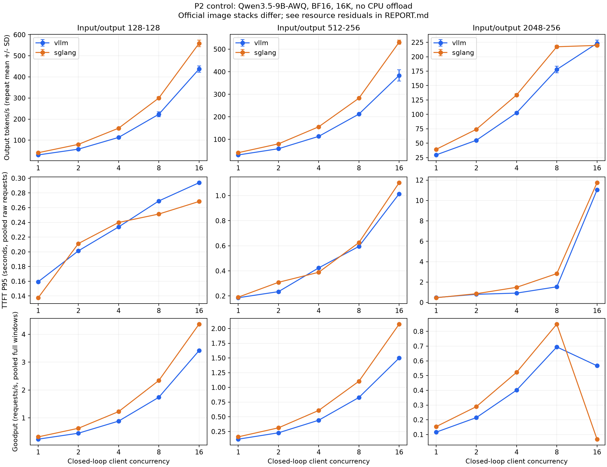
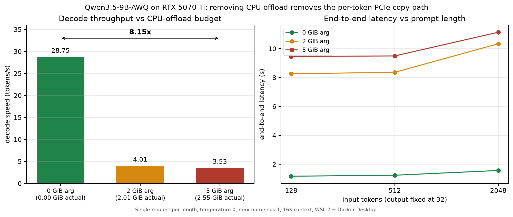
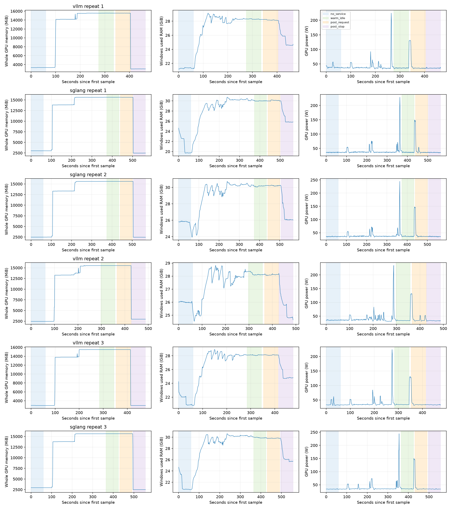
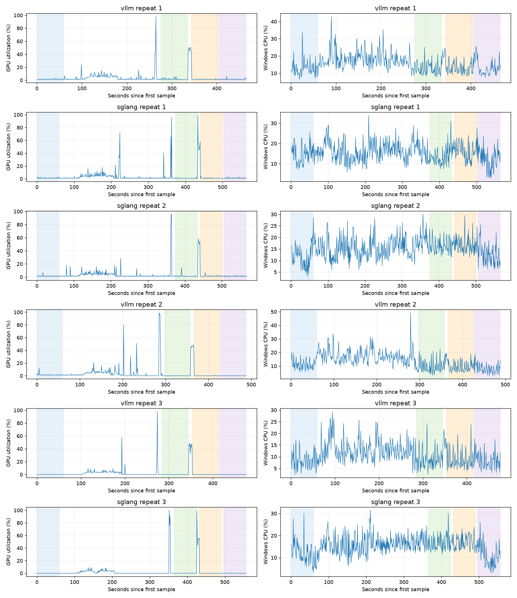
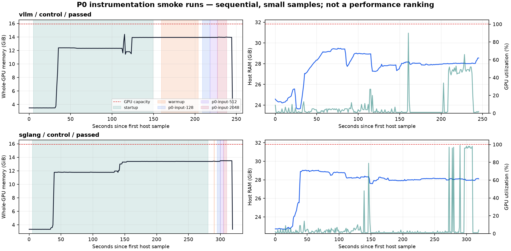
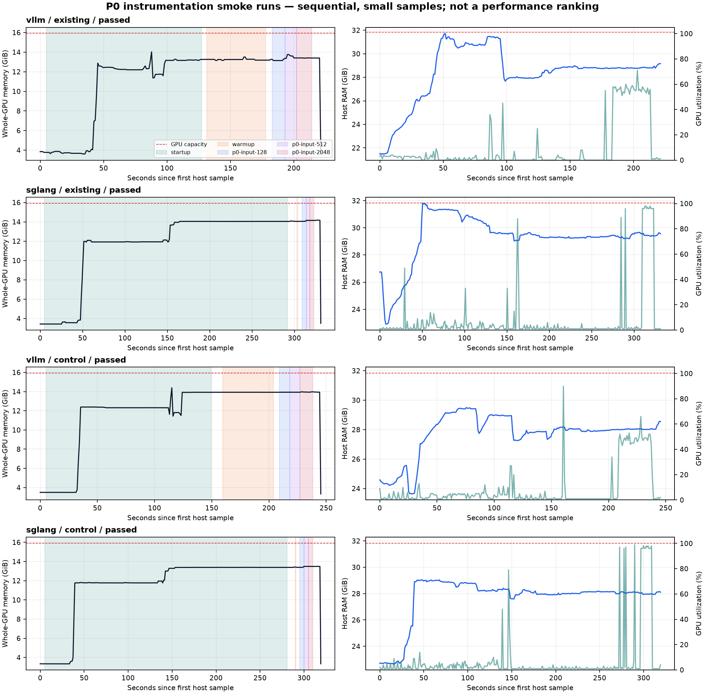

# LLM-Serving：单卡 LLM 推理性能诊断与框架对照

在 RTX 5070 Ti（16303 MiB）上，以同一份 `QuantTrio/Qwen3.5-9B-AWQ` 模型对比 vLLM 与 SGLang。项目完成了推理兼容性修正、CPU 卸载瓶颈诊断、实际资源校准、资源生命周期测量，以及带延迟约束的并发测试。

## 核心结论

| 问题 | 实测结果 | 结论 |
| --- | --- | --- |
| CPU 卸载为什么拖慢 Decode？ | vLLM 关闭卸载并提高显存预算后，Decode 中位数由 **3.53 → 28.75 tok/s**，约 **8.15 倍** | 日志、源码与拷贝探针支持逐层 CPU→GPU 权重搬运造成开销的解释；该实验同时改变了显存预算，属于瓶颈诊断 |
| 如何避免只按配置参数比较资源？ | 两框架 GPU 参数均为 **10977765888 bytes**，CPU 参数均为 **0**；实际缓存池相差 **0.6659%** | 以去重后的张量存储字节校准资源，比直接比较显存比例或 token 池大小更有依据 |
| 正式测试完成了多少？ | 筛选与正式测试各 **90 个实验单元**；分别成功 **2700 / 10098 条请求**，请求错误均为 **0** | 完成三档负载、五档并发、三次独立重复的对照矩阵 |
| 谁的吞吐更高？ | 在三档负载各自的最大达标已测并发下，SGLang 输出吞吐比 vLLM 高约 **22.3%–38.4%** | 本机 Control 配置下 SGLang 在这三个工作点的吞吐更高、E2E P95 更低；部分工作点 vLLM 的 TTFT P95 更低 |
| 吞吐更高是否意味着容量更大？ | 两框架在 128/128、512/256、2048/256 负载下，三轮均达标的最大已测闭环并发都是 **16 / 16 / 8** | 请求成功、总吞吐与延迟达标需要分别判断；2048/256 在并发 16 时，两框架都未通过本次 SLO |
| 逻辑缓存占用归零后，显存是否释放？ | 空闲时原生 KV/SSM gauge 可为 0，但约 **1.5 GiB** 的预分配池仍驻留；停服后整卡显存大幅下降 | 逻辑占用、预分配池、PyTorch allocator 和整卡显存分别计量，避免把一个指标当作全部内存状态 |

上述结论对应本机 Windows / WSL 2 / Docker Desktop 下的两套镜像与依赖栈。
后文给出实验条件、完整并发结果和结果汇总图。

## 完成的工作

| 工作 | 具体实现与验证 | 代码与结果 |
| --- | --- | --- |
| 修正推理兼容性问题 | 处理 Qwen3.5 文本模式与计算精度兼容性；为 SGLang 增加只卸载 MLP 的选择逻辑，保留归一化与 GDN 相关参数在 GPU，避免加载时的设备冲突 | [MLP 卸载补丁](docker/sglang/patch_offload.py)、[两框架采集验收](benchmark/reports/P0-REPORT.md) |
| 定位 CPU 卸载瓶颈 | 设计 5/2/0 GiB 卸载预算对照，结合实际驻留字节、安装版源码、运行日志与 PCIe 拷贝标尺解释 Decode 变化 | [卸载实验脚本](benchmark/scripts/run_offload_ablation.py)、[诊断报告](benchmark/reports/OFFLOAD-ABLATION.md) |
| 校准实际资源 | 编写启动张量探针，按 storage 指针去重统计参数、缓冲区与缓存池；探针放在启动阶段，未挂钩推理 forward；将 CPU 参数为 0 作为验收条件 | [张量探针](benchmark/scripts/p2_startup_probe.py)、[资源账本](benchmark/p2/control/resource-alignment.json) |
| 构建并发测试流程 | 使用合成请求，核对两框架完整输入 token IDs；固定输出长度，区分校准、预热、筛选和正式测试；支持完成单元跳过、中断单元重测 | [并发测试脚本](benchmark/scripts/run_p2.py)、[正式校验](benchmark/p2/control/validation.json) |
| 处理统计与计数口径 | 从合并后的原始请求重算分位数；吞吐窗口包含最后请求的收尾；同时统计逐轮吞吐、标准差、Goodput 与 SLO 达标率，并与框架原生计数核对 | [统计与验收脚本](benchmark/scripts/report_p2.py)、[汇总 CSV](benchmark/p2/control/aggregate.csv) |
| 测量资源生命周期 | 每框架三次独立启动，记录启动前、预热空闲、请求后、停服后共 24 个观察窗口，结合 GPU、主机、cgroup 与原生指标检查资源变化 | [基线脚本](benchmark/scripts/run_baseline.py)、[资源基线报告](benchmark/baseline/control/REPORT.md) |

## 实验范围与比较条件

| 阶段 | 完成内容 | 样本与验收结果 |
| --- | --- | --- |
| P0：采集验收 | 核对模型、tokenizer、流式计时、原生计数与资源采样 | 两组控制候选均通过；共 6 条测量请求、2 条预热 |
| P1：卸载诊断 | 比较 vLLM 5/2/0 GiB 卸载预算，检查显式 H2D 拷贝路径 | 每组 3 条测量请求；Decode 中位数 3.53 / 4.01 / 28.75 tok/s |
| P2：资源校准 | 统一计算与执行条件，按实际张量字节校准缓存预算 | GPU 参数字节一致、CPU 参数为 0、缓存池残差 0.6659% |
| P3：资源生命周期 | 测量启动、空闲、请求后和停服后的资源状态 | 6 次独立启动、24 个 60 秒窗口、6 条测量请求、24 条预热，校验通过 |
| P4：正式并发对照 | 三档负载 × 五档并发 × 三次重复 × 两框架 | 筛选与正式各 90 单元；正式 10098 条成功请求、0 请求错误，6 个正式单元未通过延迟 SLO |

P3/P4 使用经 P2 校准的 **Control 配置**：同一 AWQ checkpoint、tokenizer 与聊天模板，BF16 计算、16K 上下文、0 GiB CPU 卸载、512-token prefill 分块，服务端并发上限 16；关闭 CUDA Graph、前缀缓存和 thinking。
P0 与 P1 保留各自的诊断条件，结果分批解释。

两套镜像中的依赖有部分差异，如表：

| 框架 | 框架版本 | PyTorch | CUDA 构建 | Transformers | Tokenizers | FlashInfer | Triton |
| --- | --- | --- | --- | --- | --- | --- | --- |
| vLLM | 0.32.0 | 2.13.0+cu130 | 13.0 | 5.19.0 | 0.23.3 | 0.7.0.post1 | 3.7.1 |
| SGLang | 0.5.22 | 2.14.1+cu130 | 13.0 | 5.19.0 | 0.23.2 | 0.7.1 | 3.8.0 |

## 正式并发结果：吞吐、尾延迟与容量

正式测试使用 128/128、512/256、2048/256 三档输入/输出 tokens，客户端闭环并发为 1/2/4/8/16。每个实验单元至少 100 条成功请求、持续至少 60 秒，进行三次独立容器重复。预热与校准不计入正式统计。

### 最大达标已测并发下的表现

下表来自三轮合并请求。吞吐为系统总输出吞吐；延迟均为 P95，单位 ms。

| 输入/输出 tokens | 并发 | 框架 | 输出 tok/s | TTFT P95 | TPOT P95 | E2E P95 | SLO 达标率 |
| --- | ---: | --- | ---: | ---: | ---: | ---: | ---: |
| 128/128 | 16 | vLLM | 437.11 | 293.87 | 36.74 | 4917.55 | 100.00% |
| 128/128 | 16 | SGLang | **558.69** | 268.41 | 27.64 | **3704.63** | 100.00% |
| 512/256 | 16 | vLLM | 383.56 | **1014.39** | 38.67 | 10569.30 | 100.00% |
| 512/256 | 16 | SGLang | **530.98** | 1102.75 | 29.41 | **7791.62** | 100.00% |
| 2048/256 | 8 | vLLM | 177.76 | **1537.41** | 42.61 | 12007.12 | 100.00% |
| 2048/256 | 8 | SGLang | **217.31** | 2831.38 | 34.03 | **9237.58** | 100.00% |

SGLang 在这三个工作点的吞吐分别高约 27.8%、38.4%、22.3%。其中后两档负载的首 token 尾延迟由 vLLM 更低，不能只按一个吞吐数字判断所有响应体验。

### 负载边界：请求零错误，仍然可能不达标

| 输入/输出 tokens | 并发 | 框架 | 输出 tok/s | TTFT P95 / ms | E2E P95 / ms | SLO 达标率 |
| --- | ---: | --- | ---: | ---: | ---: | ---: |
| 2048/256 | 16 | vLLM | 223.20 | 11033.44 | 23281.40 | 65.00% |
| 2048/256 | 16 | SGLang | 219.66 | 11740.10 | 18348.63 | 8.00% |

这两个工作点的请求都成功完成，但延迟达标率低于 95%。据此，两框架在最长已测负载下的最大达标已测并发均为 8；短、中负载均为 16。并发 16 为本次扫描上限。

测试的合成 SLO 为：三档输入的 TTFT 分别不超过 2/3/5 秒，TPOT 不超过 100 ms，E2E 不超过对应 TTFT 阈值加输出目标 × 100 ms；请求错误率不超过 1%，延迟达标率不低于 95%。Goodput 只计同时满足三项延迟阈值的成功请求。

**图 1：正式并发测试的吞吐与延迟对照**

[SVG 图](benchmark/p2/control/comparison.svg) · [完整正式报告](benchmark/p2/control/REPORT.md) · [各轮结果 CSV](benchmark/p2/control/cell-results.csv)

展开全部正式结果：30 个工作点，每点 3 次重复，共 10098 条成功请求

表中每个工作点合并三轮请求，分位数由合并后的原始请求重算；SLO 达标率为请求层面比例。三轮是否全部达标另见汇总 CSV 的 `all_repeat_slo_pass` 字段。

| 输入/输出 tokens | 并发 | 框架 | 成功请求 | 输出 tok/s | TTFT P95 / ms | TPOT P95 / ms | E2E P95 / ms | Goodput req/s | SLO 达标率 |
| --- | ---: | --- | ---: | ---: | ---: | ---: | ---: | ---: | ---: |
| 128/128 | 1 | vLLM | 300 | 30.30 | 159.37 | 34.59 | 4520.47 | 0.24 | 100.00% |
| 128/128 | 1 | SGLang | 300 | 40.77 | 137.63 | 24.76 | 3259.67 | 0.32 | 100.00% |
| 128/128 | 2 | vLLM | 300 | 57.67 | 201.35 | 36.27 | 4741.80 | 0.45 | 100.00% |
| 128/128 | 2 | SGLang | 300 | 80.31 | 211.26 | 24.60 | 3290.20 | 0.63 | 100.00% |
| 128/128 | 4 | vLLM | 300 | 113.28 | 233.85 | 35.40 | 4656.47 | 0.88 | 100.00% |
| 128/128 | 4 | SGLang | 300 | 156.97 | 239.90 | 25.20 | 3364.11 | 1.23 | 100.00% |
| 128/128 | 8 | vLLM | 330 | 222.75 | 269.13 | 36.21 | 4769.42 | 1.74 | 100.00% |
| 128/128 | 8 | SGLang | 432 | 299.82 | 251.33 | 26.20 | 3511.49 | 2.34 | 100.00% |
| 128/128 | 16 | vLLM | 640 | 437.11 | 293.87 | 36.74 | 4917.55 | 3.41 | 100.00% |
| 128/128 | 16 | SGLang | 800 | 558.69 | 268.41 | 27.64 | 3704.63 | 4.36 | 100.00% |
| 512/256 | 1 | vLLM | 300 | 30.83 | 185.96 | 33.57 | 8715.09 | 0.12 | 100.00% |
| 512/256 | 1 | SGLang | 300 | 40.98 | 190.68 | 24.67 | 6452.78 | 0.16 | 100.00% |
| 512/256 | 2 | vLLM | 300 | 58.50 | 234.48 | 35.50 | 9262.02 | 0.23 | 100.00% |
| 512/256 | 2 | SGLang | 300 | 80.13 | 308.93 | 24.76 | 6521.35 | 0.31 | 100.00% |
| 512/256 | 4 | vLLM | 300 | 113.19 | 424.00 | 36.16 | 9566.39 | 0.44 | 100.00% |
| 512/256 | 4 | SGLang | 300 | 155.78 | 388.92 | 25.43 | 6697.88 | 0.61 | 100.00% |
| 512/256 | 8 | vLLM | 300 | 212.14 | 595.12 | 36.73 | 9844.12 | 0.83 | 100.00% |
| 512/256 | 8 | SGLang | 300 | 282.70 | 625.74 | 26.81 | 7095.01 | 1.10 | 100.00% |
| 512/256 | 16 | vLLM | 312 | 383.56 | 1014.39 | 38.67 | 10569.30 | 1.50 | 100.00% |
| 512/256 | 16 | SGLang | 384 | 530.98 | 1102.75 | 29.41 | 7791.62 | 2.07 | 100.00% |
| 2048/256 | 1 | vLLM | 300 | 29.74 | 483.26 | 34.11 | 9145.61 | 0.12 | 100.00% |
| 2048/256 | 1 | SGLang | 300 | 39.35 | 465.02 | 24.51 | 6695.49 | 0.15 | 100.00% |
| 2048/256 | 2 | vLLM | 300 | 55.05 | 801.36 | 35.90 | 9772.59 | 0.22 | 100.00% |
| 2048/256 | 2 | SGLang | 300 | 74.13 | 859.60 | 25.75 | 7083.75 | 0.29 | 100.00% |
| 2048/256 | 4 | vLLM | 300 | 102.71 | 918.93 | 37.68 | 10336.24 | 0.40 | 100.00% |
| 2048/256 | 4 | SGLang | 300 | 133.69 | 1486.51 | 28.59 | 7831.21 | 0.52 | 100.00% |
| 2048/256 | 8 | vLLM | 300 | 177.76 | 1537.41 | 42.61 | 12007.12 | 0.69 | 100.00% |
| 2048/256 | 8 | SGLang | 300 | 217.31 | 2831.38 | 34.03 | 9237.58 | 0.85 | 100.00% |
| 2048/256 | 16 | vLLM | 300 | 223.20 | 11033.44 | 63.45 | 23281.40 | 0.57 | 65.00% |
| 2048/256 | 16 | SGLang | 300 | 219.66 | 11740.10 | 34.01 | 18348.63 | 0.07 | 8.00% |

展开全部筛选结果：30 个工作点，每点 3 次重复，共 2700 条成功请求

筛选每单元至少 30 条成功请求，与正式样本分开统计。

| 输入/输出 tokens | 并发 | 框架 | 成功请求 | 输出 tok/s | TTFT P95 / ms | TPOT P95 / ms | E2E P95 / ms | Goodput req/s | SLO 达标率 |
| --- | ---: | --- | ---: | ---: | ---: | ---: | ---: | ---: | ---: |
| 128/128 | 1 | vLLM | 90 | 30.55 | 176.17 | 34.20 | 4453.49 | 0.24 | 100.00% |
| 128/128 | 1 | SGLang | 90 | 40.62 | 137.88 | 24.64 | 3237.96 | 0.32 | 100.00% |
| 128/128 | 2 | vLLM | 90 | 58.47 | 227.97 | 35.07 | 4658.24 | 0.46 | 100.00% |
| 128/128 | 2 | SGLang | 90 | 79.35 | 211.42 | 24.63 | 3308.65 | 0.62 | 100.00% |
| 128/128 | 4 | vLLM | 90 | 105.12 | 266.96 | 37.98 | 5012.84 | 0.82 | 100.00% |
| 128/128 | 4 | SGLang | 90 | 143.59 | 373.13 | 25.68 | 3499.44 | 1.12 | 100.00% |
| 128/128 | 8 | vLLM | 90 | 212.20 | 344.98 | 35.97 | 4741.08 | 1.66 | 100.00% |
| 128/128 | 8 | SGLang | 90 | 274.19 | 366.98 | 26.04 | 3615.30 | 2.14 | 100.00% |
| 128/128 | 16 | vLLM | 90 | 387.94 | 388.38 | 35.96 | 4907.39 | 3.03 | 100.00% |
| 128/128 | 16 | SGLang | 90 | 489.98 | 416.72 | 29.68 | 4090.17 | 3.83 | 100.00% |
| 512/256 | 1 | vLLM | 90 | 30.97 | 190.06 | 33.92 | 8783.66 | 0.12 | 100.00% |
| 512/256 | 1 | SGLang | 90 | 40.98 | 197.20 | 24.51 | 6438.21 | 0.16 | 100.00% |
| 512/256 | 2 | vLLM | 90 | 58.68 | 294.58 | 35.38 | 9244.18 | 0.23 | 100.00% |
| 512/256 | 2 | SGLang | 90 | 80.50 | 271.15 | 24.89 | 6566.36 | 0.31 | 100.00% |
| 512/256 | 4 | vLLM | 90 | 105.59 | 516.51 | 38.15 | 10077.26 | 0.41 | 100.00% |
| 512/256 | 4 | SGLang | 90 | 145.09 | 402.93 | 25.39 | 6788.83 | 0.57 | 100.00% |
| 512/256 | 8 | vLLM | 90 | 204.00 | 763.10 | 38.31 | 10447.69 | 0.80 | 100.00% |
| 512/256 | 8 | SGLang | 90 | 270.82 | 663.69 | 27.18 | 7294.91 | 1.06 | 100.00% |
| 512/256 | 16 | vLLM | 90 | 376.39 | 1161.66 | 37.98 | 10765.40 | 1.47 | 100.00% |
| 512/256 | 16 | SGLang | 90 | 496.73 | 998.40 | 29.05 | 7845.95 | 1.94 | 100.00% |
| 2048/256 | 1 | vLLM | 90 | 29.62 | 499.90 | 33.60 | 9073.08 | 0.12 | 100.00% |
| 2048/256 | 1 | SGLang | 90 | 39.03 | 467.60 | 24.98 | 6807.26 | 0.15 | 100.00% |
| 2048/256 | 2 | vLLM | 90 | 54.31 | 844.07 | 36.28 | 10058.27 | 0.21 | 100.00% |
| 2048/256 | 2 | SGLang | 90 | 72.92 | 884.30 | 26.42 | 7283.24 | 0.28 | 100.00% |
| 2048/256 | 4 | vLLM | 90 | 95.90 | 1382.35 | 37.90 | 10643.58 | 0.37 | 100.00% |
| 2048/256 | 4 | SGLang | 90 | 125.59 | 1504.16 | 28.46 | 7875.69 | 0.49 | 100.00% |
| 2048/256 | 8 | vLLM | 90 | 167.68 | 2875.20 | 44.48 | 13292.16 | 0.65 | 100.00% |
| 2048/256 | 8 | SGLang | 90 | 209.73 | 2773.79 | 34.33 | 9420.69 | 0.82 | 100.00% |
| 2048/256 | 16 | vLLM | 90 | 205.43 | 14068.72 | 70.21 | 25752.39 | 0.60 | 74.44% |
| 2048/256 | 16 | SGLang | 90 | 211.99 | 11692.44 | 34.35 | 18316.15 | 0.22 | 26.67% |

## CPU 卸载诊断：逐层权重搬运与 Decode 开销

vLLM 在本机环境中使用 `UVAOffloader`，但框架判定 pinned memory / UVA 路径不可用，走显式 H2D 拷贝回退。安装版源码在模块 forward 内为 CPU 参数构造 GPU 副本，运行日志记录了实际卸载量。结合拷贝探针，这些证据支持逐层权重搬运是 Decode 开销来源之一。

| 卸载预算 | 实际卸载 | GPU 权重 | 显存预算比例 | Decode 中位数 | 到 ready |
| --- | ---: | ---: | ---: | ---: | ---: |
| 5 GiB | 2.55 GiB | 7.74 GiB | 0.72 | 3.53 tok/s | 115.2 s |
| 2 GiB | 2.01 GiB | 8.28 GiB | 0.72 | 4.01 tok/s | 108.5 s |
| 0 GiB | 0 | 10.28 GiB | 0.80 | **28.75 tok/s** | 114.8 s |

5 GiB 与 2 GiB 是预算上限，实际值由可卸载模块与分配方式决定。0 GiB 组在比例 0.72 下无法满足 16K 所需缓存，调整为 0.80 后运行成功；因此 **8.15 倍是本次配置调整后的观测提升，不能全部归因于单独关闭卸载**。每组只有三条测量请求。

按实际卸载量与 Decode 速率估算，5 GiB 组的有效搬运速率约 8.99 GiB/s；同镜像 pageable H2D 拷贝标尺为 17.23 GiB/s。该估算包含计算和调用开销，没有 profiler trace，不能据此断言 PCIe 已饱和。

**图 2：卸载预算与 Decode、端到端延迟的关系**

[SVG 图](benchmark/figures/offload-ablation.svg) · [完整诊断报告](benchmark/reports/OFFLOAD-ABLATION.md) · [逐请求 CSV](benchmark/processed/offload-ablation.csv)

## 资源校准：按实际张量字节建立比较条件

同样的显存比例或 token 池大小，并不代表两框架分配了同样的物理资源。我在启动阶段统计参数、缓冲区与缓存池，并按 storage 指针去重；两边均要求模型参数全部驻留 GPU。

| 实测资源 / bytes | vLLM | SGLang |
| --- | ---: | ---: |
| GPU 参数 | 10977765888 | 10977765888 |
| CPU 参数 | 0 | 0 |
| GPU 模型缓冲区 | 33554560 | 67649792 |
| 缓存池 | 1609039872 | 1598325152 |

实际缓存池残差为 **0.6659%**，SGLang 模型缓冲区多 **34095232 bytes**。两边的缓存布局、块粒度、状态槽与工作区仍有差异；本项目记录这些残差，并未把校准描述为所有资源完全相同。

[实际资源账本](benchmark/p2/control/resource-alignment.json) · [Control 配置记录](benchmark/p2/control/config.json)

## 资源生命周期：启动、空闲、请求后与停服后

每框架独立启动三次，交替执行。每轮覆盖启动前、预热空闲、请求后、停服后四个 60 秒窗口，共 24 个窗口；窗口采样要求至少 50 个 GPU/主机样本、跨度至少 55 秒、最大间隔不超过 5 秒。

| 框架 | 到 ready 中位数 | 预热空闲整卡显存 | 停服后整卡显存 | 停服后相对预热空闲的显存下降中位数 | 停服后相对各轮启动前的残差 |
| --- | ---: | ---: | ---: | ---: | --- |
| vLLM | 162.87 s | 15513 MiB | 2960 MiB | 12544 MiB | −303 至 +515 MiB |
| SGLang | 290.58 s | 15645 MiB | 2460 MiB | 13157 MiB | −550 至 −25 MiB |

预热空闲与停服后显存先取各轮窗口中位数，再取三轮中位数；释放量与残差按各轮配对计算。ready 包含容器重建、权重读取与引擎预热，不能直接当作纯权重加载耗时。

停服后主要驻留显存下降，但整卡指标包含桌面、驱动及其他进程。现有样本无法把剩余显存与主机 RAM 差值归因给模型泄漏或驱动缓存。

**图 3：六次独立启动的资源变化**

[SVG 图](benchmark/baseline/control/resources.svg) · [阶段资源 CSV](benchmark/baseline/control/stage-resources.csv)

**图 4：GPU 与 CPU 利用率**

原生指标还显示：KV/SSM 逻辑占用归零时，预分配缓存池仍在 GPU；SGLang 部分 gauge 在预热后约 19 秒内仍保留非零值，业务请求计数没有增加。项目保留原始 gauge 的中位数与最大值，未将可能的指标更新滞后误判成额外业务请求。

[完整资源报告](benchmark/baseline/control/REPORT.md) · [缓存与容器内存 CSV](benchmark/baseline/control/native-stage-resources.csv) · [实际存储 CSV](benchmark/baseline/control/actual-storage.csv)

## 采集验收：确认测到的是同一输入与正确指标

P0 控制候选统一 BF16、16K、显存比例 0.65、单请求、MLP 卸载预算 5 GiB、prefill 分块 512，关闭 CUDA Graph。两镜像对三档输入生成的完整 token IDs 一致，逐请求核对 usage、输出长度与框架原生计数。

| 框架 | 控制候选验收 | 成功测量请求 | 到 ready | KV token 池 | 整卡采样峰值 |
| --- | --- | ---: | ---: | ---: | ---: |
| vLLM | passed | 3/3 | 144.2 s | 57775 | 14741 MiB |
| SGLang | passed | 3/3 | 275.0 s | 16384 | 13817 MiB |

| 框架 | 输入/输出 tokens | TTFT / ms | E2E / ms |
| --- | --- | ---: | ---: |
| vLLM | 128/32 | 565.5 | 9026.0 |
| vLLM | 512/32 | 655.6 | 9306.1 |
| vLLM | 2048/32 | 2668.3 | 11397.5 |
| SGLang | 128/32 | 946.8 | 4996.4 |
| SGLang | 512/32 | 271.6 | 4319.6 |
| SGLang | 2048/32 | 899.0 | 4943.8 |

这一阶段确认采集和服务可用性。两边的实际卸载字节、缓存结构与依赖栈尚未校准，每个长度只有一条测量请求，不据此估计尾延迟或作性能排名。

**图 5：两组控制候选的资源曲线**

[SVG 图](benchmark/figures/p0-control-resources.svg) · [逐请求 CSV](benchmark/processed/p0-control-requests.csv) · [完整采集验收报告](benchmark/reports/P0-REPORT.md)

**图 6：早期部署配置与控制候选的完整探索记录**

此图包含早期不同配置的探索记录，用于保留调试背景；其中现有配置组未纳入 P0 报告展示，也未并入经资源校准后的正式框架对照。

[SVG 图](benchmark/figures/p0-resources.svg) · [探索记录汇总](benchmark/processed/p0-summary.json)

## 统计口径与结论边界

- **TTFT**：发出请求至首个非空内容 chunk；role、空 delta 和心跳不作为首 token。
- **TPOT**：由首末内容 chunk 与最终 usage 估算；一个 chunk 可能包含多个 token，精确逐 token ITL 未测。
- **输出吞吐**：总输出 tokens 除以第一条提交至最后一条响应结束的完整窗口；它与单请求 Decode 速率含义不同。
- **分位数**：合并同条件原始请求后重算 P50/P90/P95，同时保留逐轮吞吐与标准差；不把各轮 P95 取平均。
- **容量**：本次三轮都满足合成 SLO 的最大已测闭环并发；开环到达率与最大 RPS 尚未测量。
- **资源**：实际张量字节、框架原生 gauge、PyTorch allocated/reserved、容器 RAM 与整卡显存分别解释。整卡约 1 秒采样可能漏掉短峰值。
- **适用范围**：本机两套框架与依赖栈的比较，不能分离所有库版本与系统开销的贡献。SGLang 卸载消融、8192/128 正式并发矩阵、混合长度、开环到达率和静态 batch 对照尚未执行。

## 报告与数据索引

| 内容 | 报告 | 主要数据 |
| --- | --- | --- |
| 采集验收 | [P0 报告](benchmark/reports/P0-REPORT.md) | [候选组汇总](benchmark/processed/p0-control-summary.json)、[资源 CSV](benchmark/processed/p0-control-resources.csv) |
| CPU 卸载诊断 | [P1 报告](benchmark/reports/OFFLOAD-ABLATION.md) | [汇总 JSON](benchmark/processed/offload-ablation.json)、[逐请求 CSV](benchmark/processed/offload-ablation.csv) |
| 实际资源校准 | [资源账本](benchmark/p2/control/resource-alignment.json) | [Control 配置](benchmark/p2/control/config.json) |
| 资源生命周期 | [P3 报告](benchmark/baseline/control/REPORT.md) | [完整汇总](benchmark/baseline/control/summary.json)、[阶段 CSV](benchmark/baseline/control/stage-resources.csv) |
| 正式并发对照 | [P4 报告](benchmark/p2/control/REPORT.md) | [合并统计 CSV](benchmark/p2/control/aggregate.csv)、[逐单元 CSV](benchmark/p2/control/cell-results.csv) |
| 数据质量验收 | [正式测试校验](benchmark/p2/control/validation.json) | [资源基线校验](benchmark/baseline/control/validation.json) |
