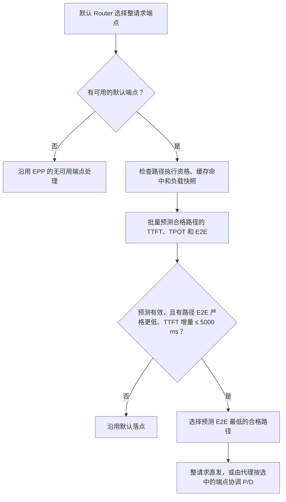

# LLM-Serving

在三节点 Linux K3s 集群上使用 NVIDIA RTX 5070 Ti 和 AMD RX 7800 XT 运行 vLLM。生产两端运行 Qwen3.5-9B-AWQ，普通 Router 在双副本之间分配整请求。生产配置 `9b-rxe` 已验证通过 Soft-RoCE 双向拉取 Prefill/Decode（P/D）的 KV Cache。仓库同时提供独立的 EPP-Opt 四路径调度实验。

## 当前部署

NAS 运行 K3s Server，两台 CachyOS 主机作为 GPU Agent。模型服务和 Router 位于 `llm-d-serving` 命名空间。

| Deployment | 配置与职责 |
| --- | --- |
| `vllm-nvidia` | RTX 5070 Ti，`vllm/vllm-openai:v0.33.0`，申请 `nvidia.com/gpu` 和 `llm-d.ai/soft-roce` |
| `vllm-amd` | RX 7800 XT，`vllm/vllm-openai-rocm:v0.33.0`，挂载 ROCm、NIXL 与支持 verbs 的 UCX，申请 `amd.com/gpu-rx-7800-xt` 和 `llm-d.ai/soft-roce` |
| `llm-serving-epp` | Helm 部署的 Envoy/EPP，根据 InferencePool 在两个 vLLM 副本之间选择整请求落点 |
| `epp-opt` | 独立实验入口，11 月 26 日验收的是现有两路径实例的普通生成 |

两个 vLLM Pod 各占一张卡，使用 `TRITON_ATTN`、16,384 token 上下文和 8 个并发序列槽位，Deployment 以 `Recreate` 更新。NIXL 保留默认兼容性检查，Decode 通过 UCX 的 `rc_verbs/rxe_llm:1` 从 Prefill 拉取 KV。数据经两端 CPU buffer 暂存，NIXL 元数据仍走 TCP。

2026 年 11 月 26 日，AMD Prefill → NVIDIA Decode 和 NVIDIA Prefill → AMD Decode 均通过握手与推理，分别在 1.378 s 和 1.343 s 内传输 381,026,304 字节。两个后端和两个入口均通过上线验收。Qwen3-0.6B 的 UCX TCP 验证和跨厂商 GPU buffer 直传诊断另有记录。 [9B Soft-RoCE 配置](llm-d/pd/soft-roce/README.md) · [P/D 验证](llm-d/pd/README.md) · [Soft-RoCE 数据路径](llm-d/pd/soft-roce/README.md#数据路径)

### 部署和访问

准备 GPU 节点、模型权重和镜像后，从仓库根目录检查集群。 `9b-rxe` 要求两端已经具备 9B P/D 配置，并已安装 RXE 节点服务和设备插件。切换前先执行服务端 dry run。 [LLM-D 部署说明](llm-d/README.md) · [Soft-RoCE 安装与回滚](llm-d/pd/soft-roce/README.md)

```bash
./llm-d/scripts/check-cluster.sh
./llm-d/pd/soft-roce/deploy.sh rxe --dry-run
./llm-d/scripts/deploy.sh 9b-rxe linux
./llm-d/scripts/status.sh
./llm-d/scripts/smoke.sh
```

已有 EPP-Opt 实例可用同一脚本验收。

```bash
LLMD_ROUTER_SERVICE=epp-opt ./llm-d/scripts/smoke.sh
```

### EPP-Opt 构建与选路

四路径版本注册 Go `e2e-aware-pd-profile-handler`，使用普通 Router 的整请求落点作为比较基准和回退路径。独立预测 Pod 批量估算各条路径的 TTFT 和 TPOT，并用已完成请求的反馈更新模型。EPP 用同一输出预算比较 AMD 整请求、NVIDIA 整请求、AMD Prefill → NVIDIA Decode（AP-ND）及 NVIDIA Prefill → AMD Decode（NP-AD）。 [EPP-Opt 构建与部署](llm-d/epp-opt/README.md)

#### 优化路由决策树



```text
预测 E2E = 预测 TTFT + max(预计输出 token 数 − 1, 0) × 预测 TPOT
```

TTFT 是首 token 延迟，P/D 路径的 TTFT 包含 KV 交接和 Decode 等待。TPOT 是首 token 后的平均生成时间。两个 P/D 方向默认关闭，使用与模型和运行配置对应的实测结果，通过 `--verified-pd ap-nd` 或 `--verified-pd np-ad` 逐方向开启。 [E2E 插件配置](llm-d/epp-opt/epp-opt-benefit-plugins.yaml) · [Go 选路实现](llm-d/epp-opt/handler/handler.go)

## 历史压测

### 9B 两路径 E2E 混合压测

Qwen3.5-9B-AWQ 双端各 8 个序列槽，在 8、16、24 三档并发完成 18 个配对波，两臂各完成 288/288 条请求。当时仅比较 AMD 整请求和 AP-ND，使用绝对 TTFT 上限 5 秒。进入 E2E 比较的 123 条请求中，76 条的 P/D 预测 E2E 更短，其预测 TTFT 均超过 5 秒。 [四路径校准设计](benchmark/pd/DESIGN.md)

### AMD Prefill → NVIDIA Decode 配对基线

Qwen3-0.6B 共完成 111 个正式运行组、33 轮配对。下表为两端预热 1920 token、NVIDIA 有 4 条背景流且无排队、4 条新请求同时到达的输出长度对照。输入为 2048 token。
差值为 P/D 与 AMD 完成整请求的差值。E2E 差值和变化率均取三轮配对的中位数，每轮变化率为该轮 E2E 差值除以 AMD 整请求的 E2E，负值表示缩短。goodput 按整组达标请求数除以总墙钟时间计算。

配对基线的完整报告、负载设计和 SLO 记录保存在本地。

| 输出 token | E2E 差值（秒） | E2E 变化率 | P/D E2E 胜出 | 总 goodput 差值（req/s） |
| ---: | ---: | ---: | ---: | ---: |
| 256 | +0.157 | +4.6% | 0/3 | −0.007 |
| 512 | −0.402 | −5.9% | 3/3 | −0.013 |
| 1024 | −1.459 | −10.8% | 3/3 | +0.069 |
| 2048 | −3.767 | −13.9% | 3/3 | +0.047 |

- **长输出收益来自 NVIDIA 显卡更快的 Decode。** 2048 输出档的 TPOT 从 AMD 的 13.181 ms 降到 P/D 的 10.993 ms。1024 和 2048 输出档同时通过 E2E、SLO、总 goodput 和已有流退化判据。
- **NVIDIA 整请求与原路由形成独立对照。** 2048 输出档中，P/D 对原路由方式的 E2E 配对差中位数为 −1.508 s，胜出 2/3 轮。
- **P/D 收益限制为 Decode 排队和大 KV 交接。** 热前缀 `2048/2048` 下，NVIDIA 从空闲到 8 条运行、2 条等待时，P/D TTFT 从 0.743 s 升到 8.629 s。
