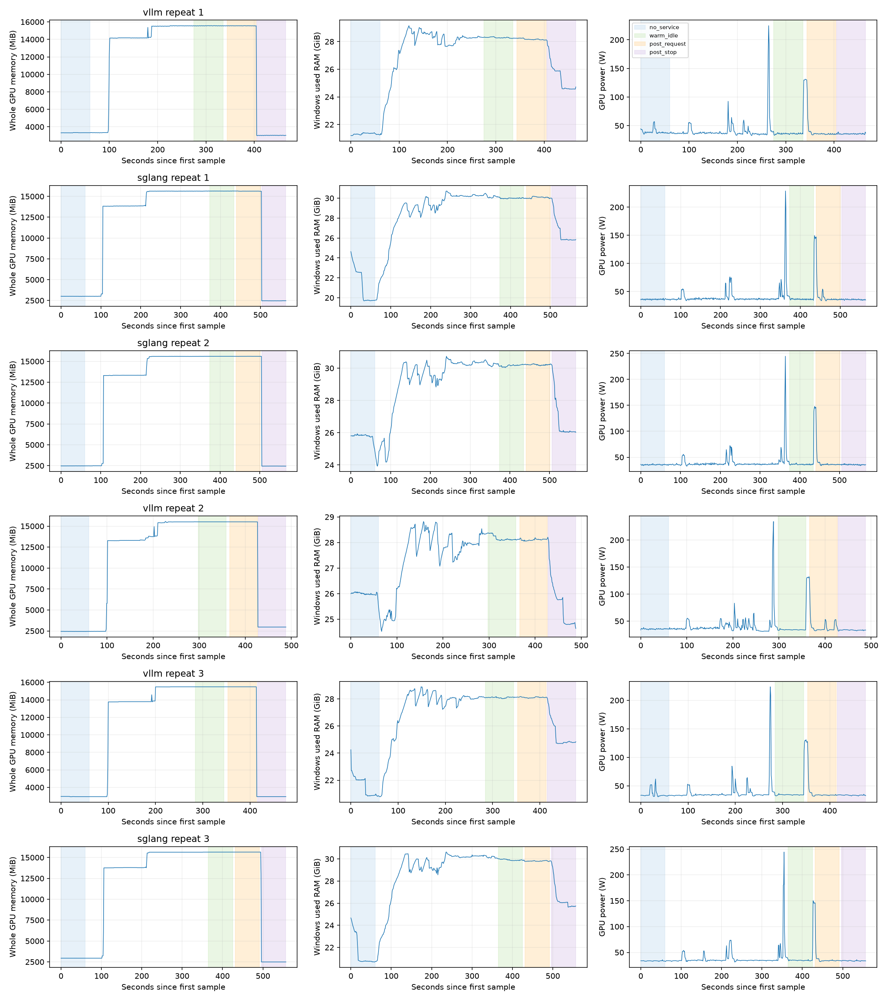
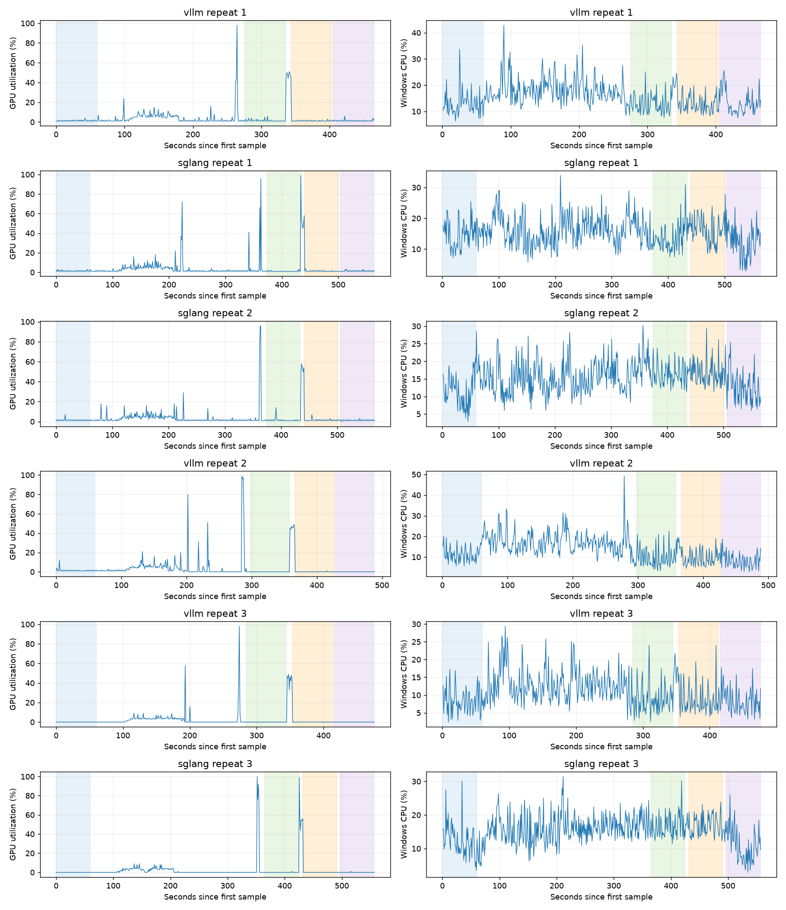

# P3：Control 启动、空闲与释放基线

完成 6/6 次独立启动，校验通过。目标为每框架三轮，已记录 24 个 60 秒观察窗口。

## 结果概览

| 框架 | 预热空闲整卡 MiB | 停服后整卡 MiB | 停服后相对本轮启动前的残差 MiB |
| --- | ---: | ---: | --- |
| vllm | 15513 | 2960 | -303 至 +515 |
| sglang | 15645 | 2460 | -550 至 -25 |

整卡显存包含桌面和其他进程。容器停止后显存下降，支持主要驻留占用释放；剩余的显存与主机 RAM 差值，现有采样无法归因给模型、桌面进程或驱动缓存。

## 配置与流程

本次沿用 P2 冻结 Control：BF16、16K、0 GiB CPU 卸载、服务端并发上限 16，关闭 Graph 和前缀缓存。vLLM 显式缓存预算 1.5 GiB；SGLang 比例 0.90、17 个状态槽和 20480 token 池。生产 `.env` 默认配置另有参数，未在本批测量。

每框架独立启动三次，交替执行。每轮按下列顺序记录资源：

1. 无服务观察 60 秒。
2. 启动服务，等待 /health 成功。
3. 依次预热 128/512/2048/8192 输入，各输出 8 tokens，再空闲观察 60 秒。
4. 发一条 512/256 测量请求，再观察 60 秒。
5. 停服，再观察 60 秒。

已完成轮次的 6 条测量请求与 24 条预热分开保存。脚本核对单请求原生计数增量为 1/512/256，并检查空闲段没有额外业务请求。

ready 从 Compose 启动调用前计到 /health 首次成功，包含容器重建、权重读取和引擎预热，健康检查间隔约 3 秒。表中的首次预热为 128/8，其耗时与 512/256 测量请求分开统计。

## 各轮启动与释放

| 框架 / 轮次 | ready 秒 | 首次预热 E2E 秒 | 测量请求 E2E 秒 | 停服秒 | 整卡峰值 MiB | 停服后 − 无服务 MiB | 主机 RAM 差 GiB |
| --- | ---: | ---: | ---: | ---: | ---: | ---: | ---: |
| vllm / 1 | 153.09 | 42.016 | 8.347 | 1.29 | 15568 | -303.0 | +3.885 |
| sglang / 1 | 290.58 | 1.271 | 6.522 | 3.46 | 15652 | -550.0 | +5.721 |
| sglang / 2 | 291.25 | 1.188 | 6.508 | 4.74 | 15614 | -25.0 | +0.240 |
| vllm / 2 | 175.28 | 42.103 | 8.430 | 1.24 | 15549 | +515.0 | -0.231 |
| vllm / 3 | 162.87 | 41.398 | 8.624 | 2.15 | 15488 | +3.0 | +2.793 |
| sglang / 3 | 282.28 | 1.163 | 6.501 | 4.84 | 15649 | -453.0 | +5.299 |

## 各阶段资源

各轮先取 60 秒窗口的中位数，再取三轮中位数；括号为轮间最小值至最大值。no_service 为启动前，warm_idle 为预热空闲，post_request 为请求后，post_stop 为停服后。

| 框架 | 阶段 | 整卡 MiB | 主机 RAM GiB | GPU 利用率 % | GPU 功耗 W |
| --- | --- | ---: | ---: | ---: | ---: |
| vllm | no_service_60s | 2941.00 (2445.00–3324.00) | 22.00 (21.32–25.99) | 1.00 (0.00–1.00) | 35.30 (33.24–37.94) |
| vllm | warm_idle_60s | 15513.00 (15488.00–15562.00) | 28.12 (28.11–28.29) | 0.00 (0.00–1.00) | 34.36 (34.09–35.74) |
| vllm | post_request_60s | 15512.00 (15488.00–15561.00) | 28.11 (28.10–28.16) | 0.00 (0.00–1.00) | 34.18 (33.95–35.51) |
| vllm | post_stop_60s | 2960.00 (2944.00–3021.00) | 25.21 (24.80–25.76) | 0.00 (0.00–1.00) | 33.72 (33.35–35.40) |
| sglang | no_service_60s | 2944.00 (2475.00–3010.00) | 20.76 (20.11–25.83) | 1.00 (0.00–1.00) | 35.42 (33.65–35.88) |
| sglang | warm_idle_60s | 15645.00 (15607.00–15648.00) | 29.99 (29.90–30.17) | 1.00 (0.00–1.00) | 35.89 (34.57–36.03) |
| sglang | post_request_60s | 15630.00 (15607.00–15649.00) | 30.09 (29.80–30.21) | 1.00 (0.00–1.00) | 35.86 (34.16–36.03) |
| sglang | post_stop_60s | 2460.00 (2450.00–2491.00) | 26.06 (25.83–26.06) | 1.00 (0.00–1.00) | 35.58 (33.79–35.64) |

## 采样与判断限制

GPU 和 Windows CPU/RAM 约每秒采样；服务运行期间另采集 cgroup、WSL /proc、Docker stats 与 Prometheus。每窗口要求至少 50 个 GPU/主机样本，采样跨度至少 55 秒，最大间隔不超过 5 秒。整卡峰值仍可能漏过短尖峰。

本次在启动的两个时点记录 torch allocated/reserved，未在服务进程内跟踪全程 allocator 峰值。参数与缓存字节见启动张量账本。容器停止后 cgroup 无法读取，主机采样继续。

每框架只有三轮，本报告使用中位数和范围描述资源基线。正式并发数据另存于 P4；SGLang CPU 卸载消融尚未执行。

## 校验与原始数据

[阶段 CSV](stage-resources.csv) · [完整汇总](summary.json) · [校验](validation.json) · [生产恢复](restoration.json) · [执行状态](execution.json)

最终恢复记录核对生产文件哈希、恢复命令退出码与两容器停止状态。原始请求、窗口、采样、计数和张量账本在 sessions/；sources/ 保存测量脚本快照，图像输入哈希见 resources.sources.json。

## 原生缓存池与容器内存补充

以下表格来自同批原始 Prometheus、cgroup 与启动张量账本，离线汇总。

无服务窗口保留 Docker Desktop、WSL 与桌面程序。释放差值以各轮自身基线为参照。

各轮释放差值：

- vllm：停服后相对预热空闲的整卡显存下降中位数 12544 MiB（12541–12553）；相对本轮无服务基线残差 -303 至 +515 MiB；主机 RAM 残差 -0.231 至 +3.885 GiB。
- sglang：停服后相对预热空闲的整卡显存下降中位数 13157 MiB（13157–13185）；相对本轮无服务基线残差 -550 至 -25 MiB；主机 RAM 残差 +0.240 至 +5.721 GiB。

六轮均确认容器停止。下表按 storage 指针去重记录参数、缓冲区和缓存池。

| 框架 | GPU 参数字节（3 轮范围） | GPU 缓冲区字节 | CPU 参数字节 | 缓存池字节 |
| --- | ---: | ---: | ---: | ---: |
| vllm | 10977765888 | 33554560 | 0 | 1609039872 |
| sglang | 10977765888 | 67649792 | 0 | 1598325152 |

| 框架 | 权重加载后 allocated 字节 | 权重加载后 reserved 字节 | 池初始化后 allocated 字节 | 池初始化后 reserved 字节 |
| --- | ---: | ---: | ---: | ---: |
| vllm | 11059910144 | 11070865408 | 12736116736 | 12838764544 |
| sglang | 11046000128 | 11062476800 | 12646427136 | 12696158208 |

allocated/reserved 来自权重加载后、池初始化后两个时点。它们不包含非 torch 分配、驱动与桌面占用，全程峰值未测。

| 框架 / 轮次 | 阶段 | 容器 RAM 中位 GiB | 容器 swap 中位 GiB | KV 原生占用中位 / 最大 | SSM 原生占用中位 / 最大 |
| --- | --- | ---: | ---: | ---: | ---: |
| vllm / 1 | warm_idle_60s | 7.013954 | 0.000000 | 0.000000 / 0.000000 | unavailable / unavailable |
| vllm / 1 | post_request_60s | 7.014067 | 0.000000 | 0.000000 / 0.000000 | unavailable / unavailable |
| sglang / 1 | warm_idle_60s | 8.049168 | 0.000000 | 0.000000 / 0.400049 | 0.000000 / 0.058824 |
| sglang / 1 | post_request_60s | 8.011272 | 0.000000 | 0.000000 / 0.000000 | 0.000000 / 0.000000 |
| sglang / 2 | warm_idle_60s | 8.039080 | 0.000000 | 0.000000 / 0.400049 | 0.000000 / 0.058824 |
| sglang / 2 | post_request_60s | 8.001133 | 0.000000 | 0.000000 / 0.000000 | 0.000000 / 0.000000 |
| vllm / 2 | warm_idle_60s | 7.093239 | 0.000000 | 0.000000 / 0.000000 | unavailable / unavailable |
| vllm / 2 | post_request_60s | 7.092978 | 0.000000 | 0.000000 / 0.000000 | unavailable / unavailable |
| vllm / 3 | warm_idle_60s | 7.081165 | 0.000000 | 0.000000 / 0.000000 | unavailable / unavailable |
| vllm / 3 | post_request_60s | 7.081394 | 0.000000 | 0.000000 / 0.000000 | unavailable / unavailable |
| sglang / 3 | warm_idle_60s | 8.035538 | 0.000000 | 0.000000 / 0.400049 | 0.000000 / 0.058824 |
| sglang / 3 | post_request_60s | 7.997133 | 0.000000 | 0.000000 / 0.000000 | 0.000000 / 0.000000 |

KV/SSM 列保留框架原生 gauge，含义不同于 allocator reserved。SGLang 三轮预热后约 19 秒内仍报 KV=0.400049、SSM=0.058824，随后归零，业务计数没有增加。指标更新滞后是一种解释，尚未验证；表内保留最大值。逻辑占用为零时，约 1.5 GiB 的预分配池仍在 GPU。停服后的 cgroup 记为 unavailable。

[缓存与容器资源 CSV](native-stage-resources.csv) · [实际存储 CSV](actual-storage.csv)

