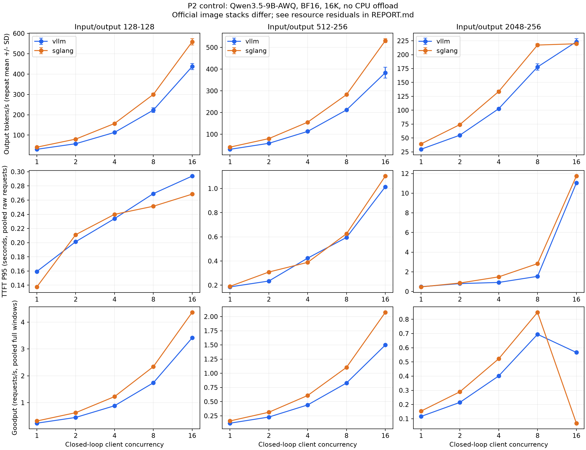

# P4：Control 正式并发测试

状态：三档负载的正式矩阵已完成。

筛选成功 2700 条，错误 0 条；正式成功 10098 条，错误 0 条。请求成功与延迟达标分别统计。

本批使用 P2 冻结的 Control 配置；配置与资源账本见 [P2 Control](../../p2/control/README.md)。本报告属于 P4 正式并发测试，按原实验计划归档。

## 最大达标已测并发

| 框架 | 输入/输出 tokens | 三轮均达标的最大已测并发 |
| --- | --- | ---: |
| vllm | 128-128 | 16 |
| vllm | 512-256 | 16 |
| vllm | 2048-256 | 8 |
| sglang | 128-128 | 16 |
| sglang | 512-256 | 16 |
| sglang | 2048-256 | 8 |

容量指三轮都满足本次 SLO 的最大已测闭环并发。开环到达率扫描尚未执行，最大 RPS 未知。

## 配置与样本

| 项目 | 设置 |
| --- | --- |
| 模型与输入 | 同一 QuantTrio/Qwen3.5-9B-AWQ、tokenizer、聊天模板，两镜像生成的完整输入 IDs 一致 |
| 计算与内存 | BF16、16K、0 GiB CPU 卸载、prefill 分块 512 |
| 执行方式 | CUDA Graph、前缀缓存、thinking 均关闭；服务端并发上限 16 |
| 工作负载 | 128/128、512/256、2048/256 输入/输出 tokens |
| 客户端 | 闭环并发 1/2/4/8/16 |
| 筛选 | 每单元至少 30 条，3 轮 |
| 正式 | 每单元至少 100 条且至少 60 秒，3 次独立容器重复 |

每轮独立启动、预热，交替框架顺序。每单元另做同长度、同并发预热；预热与校准不计正式统计。脚本保留失败请求，中断单元重测。

脚本用 `ignore_eos=true` 和 `max_tokens` 固定输出，逐条核对 usage 与 `finish_reason=length`。吞吐从第一条提交计到最后一条响应结束，包含收尾；分位数从合并后的原始请求重算，另存逐轮吞吐及标准差。TPOT 根据内容 chunk 时间和最终 usage 估算，精确逐 token ITL 未测。

## 延迟阈值

| 指标 | 冻结阈值 |
| --- | --- |
| TTFT | 输入 128/512/2048/8192 分别不超过 2/3/5/10 秒 |
| TPOT | 不超过 100 ms |
| E2E | 不超过对应 TTFT 阈值 + 输出目标 × 100 ms |
| 错误率 / 延迟达标率 | 不超过 1% / 不低于 95% |

这些是合成测试阈值，尚未按生产需求验收。Goodput 为同时满足三项延迟阈值的成功请求数除以完整窗口。

## 正式结果

表中延迟单位为 ms，分位数顺序为 P50/P90/P95。输出 tok/s 为批次总吞吐。

| 框架 | 输入/输出 | 并发 | 重复 | 成功请求 | 输出 tok/s | TTFT P50/P90/P95 ms | TPOT P50/P90/P95 ms | E2E P50/P90/P95 ms | Goodput req/s | SLO达标率 |
| --- | --- | ---: | ---: | ---: | ---: | --- | --- | --- | ---: | ---: |
| vllm | 128-128 | 1 | 3 | 300 | 30.30 | 114.84/152.60/159.37 | 32.21/33.89/34.59 | 4216.92/4439.52/4520.47 | 0.24 | 100.00% |
| vllm | 128-128 | 2 | 3 | 300 | 57.67 | 137.84/186.56/201.35 | 33.69/35.55/36.27 | 4430.20/4662.14/4741.80 | 0.45 | 100.00% |
| vllm | 128-128 | 4 | 3 | 300 | 113.28 | 156.95/208.89/233.85 | 34.10/35.02/35.40 | 4502.40/4616.94/4656.47 | 0.88 | 100.00% |
| vllm | 128-128 | 8 | 3 | 330 | 222.75 | 169.33/233.10/269.13 | 33.88/35.60/36.21 | 4486.01/4723.26/4769.42 | 1.74 | 100.00% |
| vllm | 128-128 | 16 | 3 | 640 | 437.11 | 188.57/266.95/293.87 | 34.80/36.11/36.74 | 4620.25/4800.93/4917.55 | 3.41 | 100.00% |
| vllm | 512-256 | 1 | 3 | 300 | 30.83 | 145.57/178.40/185.96 | 31.82/33.22/33.57 | 8272.45/8621.24/8715.09 | 0.12 | 100.00% |
| vllm | 512-256 | 2 | 3 | 300 | 58.50 | 199.29/224.59/234.48 | 33.57/35.12/35.50 | 8760.87/9165.08/9262.02 | 0.23 | 100.00% |
| vllm | 512-256 | 4 | 3 | 300 | 113.19 | 318.95/408.19/424.00 | 34.06/35.58/36.16 | 9002.04/9378.94/9566.39 | 0.44 | 100.00% |
| vllm | 512-256 | 8 | 3 | 300 | 212.14 | 432.16/544.91/595.12 | 34.66/36.32/36.73 | 9281.01/9708.21/9844.12 | 0.83 | 100.00% |
| vllm | 512-256 | 16 | 3 | 312 | 383.56 | 498.37/736.56/1014.39 | 37.05/38.48/38.67 | 9912.09/10272.68/10569.30 | 1.50 | 100.00% |
| vllm | 2048-256 | 1 | 3 | 300 | 29.74 | 443.19/479.14/483.26 | 31.94/33.16/34.11 | 8591.11/8910.98/9145.61 | 0.12 | 100.00% |
| vllm | 2048-256 | 2 | 3 | 300 | 55.05 | 610.61/790.67/801.36 | 34.01/35.43/35.90 | 9323.04/9685.99/9772.59 | 0.22 | 100.00% |
| vllm | 2048-256 | 4 | 3 | 300 | 102.71 | 795.98/899.36/918.93 | 36.15/37.33/37.68 | 9988.84/10283.55/10336.24 | 0.40 | 100.00% |
| vllm | 2048-256 | 8 | 3 | 300 | 177.76 | 807.56/958.89/1537.41 | 40.49/42.09/42.61 | 11116.91/11735.37/12007.12 | 0.69 | 100.00% |
| vllm | 2048-256 | 16 | 3 | 300 | 223.20 | 2844.49/10836.59/11033.44 | 46.98/49.24/63.45 | 15392.79/23062.36/23281.40 | 0.57 | 65.00% |
| sglang | 128-128 | 1 | 3 | 300 | 40.77 | 104.56/131.60/137.63 | 23.88/24.59/24.76 | 3138.41/3238.65/3259.67 | 0.32 | 100.00% |
| sglang | 128-128 | 2 | 3 | 300 | 80.31 | 134.59/193.62/211.26 | 23.75/24.37/24.60 | 3164.69/3259.96/3290.20 | 0.63 | 100.00% |
| sglang | 128-128 | 4 | 3 | 300 | 156.97 | 146.12/207.16/239.90 | 24.10/25.01/25.20 | 3225.95/3337.88/3364.11 | 1.23 | 100.00% |
| sglang | 128-128 | 8 | 3 | 432 | 299.82 | 161.72/214.06/251.33 | 25.03/26.02/26.20 | 3353.22/3482.76/3511.49 | 2.34 | 100.00% |
| sglang | 128-128 | 16 | 3 | 800 | 558.69 | 182.01/232.17/268.41 | 26.04/27.36/27.64 | 3497.84/3677.03/3704.63 | 4.36 | 100.00% |
| sglang | 512-256 | 1 | 3 | 300 | 40.98 | 156.19/182.67/190.68 | 23.80/24.50/24.67 | 6231.55/6411.46/6452.78 | 0.16 | 100.00% |
| sglang | 512-256 | 2 | 3 | 300 | 80.13 | 231.71/263.83/308.93 | 24.13/24.64/24.76 | 6376.74/6494.62/6521.35 | 0.31 | 100.00% |
| sglang | 512-256 | 4 | 3 | 300 | 155.78 | 304.35/371.69/388.92 | 24.49/25.21/25.43 | 6534.51/6666.62/6697.88 | 0.61 | 100.00% |
| sglang | 512-256 | 8 | 3 | 300 | 282.70 | 401.37/604.99/625.74 | 25.37/26.57/26.81 | 6897.50/7046.89/7095.01 | 1.10 | 100.00% |
| sglang | 512-256 | 16 | 3 | 384 | 530.98 | 613.15/1029.56/1102.75 | 26.77/28.99/29.41 | 7455.01/7715.03/7791.62 | 2.07 | 100.00% |
| sglang | 2048-256 | 1 | 3 | 300 | 39.35 | 434.77/456.14/465.02 | 23.78/24.36/24.51 | 6499.13/6646.11/6695.49 | 0.15 | 100.00% |
| sglang | 2048-256 | 2 | 3 | 300 | 74.13 | 644.42/824.87/859.60 | 24.50/25.57/25.75 | 6905.28/7049.76/7083.75 | 0.29 | 100.00% |
| sglang | 2048-256 | 4 | 3 | 300 | 133.69 | 1035.59/1472.72/1486.51 | 25.96/28.17/28.59 | 7608.35/7792.69/7831.21 | 0.52 | 100.00% |
| sglang | 2048-256 | 8 | 3 | 300 | 217.31 | 1510.67/2713.24/2831.38 | 28.55/33.85/34.03 | 9041.03/9185.01/9237.58 | 0.85 | 100.00% |
| sglang | 2048-256 | 16 | 3 | 300 | 219.66 | 10402.73/11680.67/11740.10 | 28.72/33.47/34.01 | 17893.75/18245.98/18348.63 | 0.07 | 8.00% |

## 实际资源与残差

vLLM 显式缓存预算为 1610612736 bytes。SGLang 固定 token 池 20480、线性状态槽 17。池结构不同，需按实际张量存储核对。

| 资源 / bytes | vLLM | SGLang |
| --- | ---: | ---: |
| CUDA 参数 | 10977765888 | 10977765888 |
| CPU 参数 | 0 | 0 |
| 缓存池 | 1609039872 | 1598325152 |

缓存池残差为 0.6659%；SGLang 模型缓冲区多 34095232 bytes。配对 run 和账本见 [resource-alignment.json](../../p2/control/resource-alignment.json)。

两边均无 CPU 参数驻留，仍存在以下差异：

- 混合缓存池的布局、块粒度、状态槽与工作区不同；客户端并发也可能因排队或抢占而高于服务端同时运行数。
- 官方镜像携带的 PyTorch、Triton、FlashInfer、tokenizers 版本不同，无法单独分离框架与依赖栈的贡献。
- Windows / WSL 2、9P 挂载和桌面后台负载影响本机结果。整卡采样包含其他进程，约 1 秒间隔可能漏掉短峰值。

因此结果适用于本机这两套 Control 实现。P0 带卸载的速率与本批分开统计。

## 校验与数据

完成单元共 183 个（含校准）；正式单元 90/90。数据校验通过：True。

| 文件 | 内容 |
| --- | --- |
| [aggregate.csv](aggregate.csv) | 合并请求后的统计 |
| [cell-results.csv](cell-results.csv) | 各单元、各轮结果 |
| [validation.json](validation.json) | 长度、usage、原生计数、完整性和凭据检查 |
| [restoration.json](restoration.json) | 生产文件哈希、容器定义恢复与停止状态 |
| sessions/ | 逐请求、流式时间戳、服务日志、GPU/主机/WSL 与原生指标 |

8192/128、混合长度、开环与静态 batch 尚未执行。续跑和退出检查见[批次说明](README.md)。

筛选结果（与正式统计分开）

| 框架 | 输入/输出 | 并发 | 已完成重复 | 成功数 | 输出 tok/s | TTFT P95 ms | E2E P95 ms |
| --- | --- | ---: | ---: | ---: | ---: | ---: | ---: |
| vllm | 128-128 | 1 | 3 | 90 | 30.55 | 176.17 | 4453.49 |
| vllm | 128-128 | 2 | 3 | 90 | 58.47 | 227.97 | 4658.24 |
| vllm | 128-128 | 4 | 3 | 90 | 105.12 | 266.96 | 5012.84 |
| vllm | 128-128 | 8 | 3 | 90 | 212.20 | 344.98 | 4741.08 |
| vllm | 128-128 | 16 | 3 | 90 | 387.94 | 388.38 | 4907.39 |
| vllm | 512-256 | 1 | 3 | 90 | 30.97 | 190.06 | 8783.66 |
| vllm | 512-256 | 2 | 3 | 90 | 58.68 | 294.58 | 9244.18 |
| vllm | 512-256 | 4 | 3 | 90 | 105.59 | 516.51 | 10077.26 |
| vllm | 512-256 | 8 | 3 | 90 | 204.00 | 763.10 | 10447.69 |
| vllm | 512-256 | 16 | 3 | 90 | 376.39 | 1161.66 | 10765.40 |
| vllm | 2048-256 | 1 | 3 | 90 | 29.62 | 499.90 | 9073.08 |
| vllm | 2048-256 | 2 | 3 | 90 | 54.31 | 844.07 | 10058.27 |
| vllm | 2048-256 | 4 | 3 | 90 | 95.90 | 1382.35 | 10643.58 |
| vllm | 2048-256 | 8 | 3 | 90 | 167.68 | 2875.20 | 13292.16 |
| vllm | 2048-256 | 16 | 3 | 90 | 205.43 | 14068.72 | 25752.39 |
| sglang | 128-128 | 1 | 3 | 90 | 40.62 | 137.88 | 3237.96 |
| sglang | 128-128 | 2 | 3 | 90 | 79.35 | 211.42 | 3308.65 |
| sglang | 128-128 | 4 | 3 | 90 | 143.59 | 373.13 | 3499.44 |
| sglang | 128-128 | 8 | 3 | 90 | 274.19 | 366.98 | 3615.30 |
| sglang | 128-128 | 16 | 3 | 90 | 489.98 | 416.72 | 4090.17 |
| sglang | 512-256 | 1 | 3 | 90 | 40.98 | 197.20 | 6438.21 |
| sglang | 512-256 | 2 | 3 | 90 | 80.50 | 271.15 | 6566.36 |
| sglang | 512-256 | 4 | 3 | 90 | 145.09 | 402.93 | 6788.83 |
| sglang | 512-256 | 8 | 3 | 90 | 270.82 | 663.69 | 7294.91 |
| sglang | 512-256 | 16 | 3 | 90 | 496.73 | 998.40 | 7845.95 |
| sglang | 2048-256 | 1 | 3 | 90 | 39.03 | 467.60 | 6807.26 |
| sglang | 2048-256 | 2 | 3 | 90 | 72.92 | 884.30 | 7283.24 |
| sglang | 2048-256 | 4 | 3 | 90 | 125.59 | 1504.16 | 7875.69 |
| sglang | 2048-256 | 8 | 3 | 90 | 209.73 | 2773.79 | 9420.69 |
| sglang | 2048-256 | 16 | 3 | 90 | 211.99 | 11692.44 | 18316.15 |

逐次启动的资源记录（含校准与中断）

缺失值记为 N/A。完整机器字段见 [resources.csv](resources.csv)。

| 运行 | 框架 | 预热整卡 MiB | 整卡峰值 MiB | CUDA 参数与缓冲区 bytes | CPU 参数 bytes | 实测缓存 bytes | vLLM KV tokens | SGLang KV tokens | SGLang Conv/SSM GiB |
| --- | --- | ---: | ---: | ---: | ---: | ---: | ---: | ---: | --- |
| run-011-vllm-calibration | vllm | 15417.00 | 15570.00 | N/A | N/A | N/A | 43,534 | N/A | N/A/N/A |
| run-012-sglang-calibration | sglang | N/A | 15456.00 | N/A | N/A | N/A | N/A | 6040 | 0.02/0.84 |
| run-013-sglang-calibration | sglang | 15399.00 | 15491.00 | N/A | N/A | N/A | N/A | 20480 | 0.02/0.84 |
| run-014-vllm-screen-r01 | vllm | 14921.00 | 14998.00 | 11011320448.00 | 0.00 | 1609039872.00 | 43,534 | N/A | N/A/N/A |
| run-015-sglang-calibration | sglang | 15488.00 | 15488.00 | 11045415680.00 | 0.00 | 1598325152.00 | N/A | 20480 | 0.02/0.84 |
| run-016-vllm-screen-r01 | vllm | 14883.00 | 15632.00 | 11011320448.00 | 0.00 | 1609039872.00 | 43,534 | N/A | N/A/N/A |
| run-017-sglang-screen-r01 | sglang | 15460.00 | 15465.00 | 11045415680.00 | 0.00 | 1598325152.00 | N/A | 20480 | 0.02/0.84 |
| run-018-sglang-screen-r02 | sglang | 15414.00 | 15676.00 | 11045415680.00 | 0.00 | 1598325152.00 | N/A | 20480 | 0.02/0.84 |
| run-019-vllm-screen-r02 | vllm | 14923.00 | 15611.00 | 11011320448.00 | 0.00 | 1609039872.00 | 43,534 | N/A | N/A/N/A |
| run-020-vllm-screen-r03 | vllm | 15006.00 | 15421.00 | 11011320448.00 | 0.00 | 1609039872.00 | 43,534 | N/A | N/A/N/A |
| run-021-sglang-screen-r03 | sglang | 15387.00 | 15391.00 | 11045415680.00 | 0.00 | 1598325152.00 | N/A | 20480 | 0.02/0.84 |
| run-022-sglang-formal-r01 | sglang | 15350.00 | 15355.00 | 11045415680.00 | 0.00 | 1598325152.00 | N/A | 20480 | 0.02/0.84 |
| run-023-vllm-formal-r01 | vllm | 14735.00 | 15626.00 | 11011320448.00 | 0.00 | 1609039872.00 | 43,534 | N/A | N/A/N/A |
| run-024-vllm-formal-r02 | vllm | 15165.00 | 15571.00 | 11011320448.00 | 0.00 | 1609039872.00 | N/A | N/A | N/A/N/A |
| run-025-vllm-formal-r02 | vllm | 15061.00 | 15266.00 | 11011320448.00 | 0.00 | 1609039872.00 | 43,534 | N/A | N/A/N/A |
| run-026-sglang-formal-r02 | sglang | 15431.00 | 15433.00 | 11045415680.00 | 0.00 | 1598325152.00 | N/A | 20480 | 0.02/0.84 |
| run-027-sglang-formal-r03 | sglang | 15431.00 | 15433.00 | 11045415680.00 | 0.00 | 1598325152.00 | N/A | 20480 | 0.02/0.84 |
| run-028-vllm-formal-r03 | vllm | 14817.00 | 14826.00 | 11011320448.00 | 0.00 | 1609039872.00 | 43,534 | N/A | N/A/N/A |

