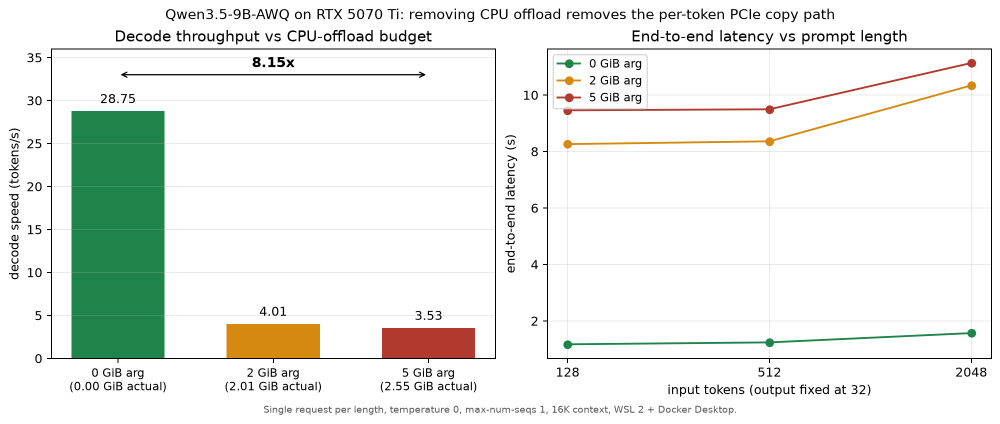

# P1：vLLM CPU 卸载诊断

对象为本机 RTX 5070 Ti、WSL 2 / Docker Desktop 上的 vLLM 0.32.0 和 `QuantTrio/Qwen3.5-9B-AWQ`。

关闭 CPU 卸载后，三条请求的 Decode 中位数从 3.53 提高到 28.75 tok/s，约 8.15 倍。日志和安装版源码支持以下解释：本机的卸载器逐层把 MLP 权重从 CPU 拷到 GPU，增加了每个 Decode 步的耗时。

0 GiB 组还将显存预算从 0.72 提高到 0.80，KV 池随之变化。每组只有一次启动、三条测量请求。这项实验用于定位瓶颈，未提供统一资源下的性能排名或置信区间。SGLang 卸载消融尚未执行。

## 配置与失败记录

三组固定 FP16、16K、服务端并发上限 1、prefill 分块 512、eager、仅卸载 MLP。请求复用 P0 的 128/512/2048 输入，输出上限 32，temperature=0、top_p=1、seed=20261030，关闭 thinking。每组先发一条预热，再发三条测量请求；失败不重试。

| 卸载预算 | 显存比例 | 说明 |
| --- | --- | --- |
| 5 GiB | 0.72 | 实际卸载 2.55 GiB |
| 2 GiB | 0.72 | 实际卸载 2.01 GiB |
| 0 GiB | 0.80 | 0.72 下可用 KV 约 0.05 GiB，小于 16K 所需的 0.61 GiB，启动失败后提高预算 |

失败记录保存在 `../runs/run-008-vllm-offload-g0.0-a0cf7b53-r01/`。显存比例与卸载量都发生变化，不能把实验描述为严格单变量消融。

## 结果

| arm | 实际卸载 | GPU 权重 | KV 池 | ready | decode 中位数 | 隐含搬运速率 |
| --- | ---: | ---: | ---: | ---: | ---: | ---: |
| 5 GiB（参数上限） | **2.55 GiB** | 7.74 GiB | 87,525 tokens | 115.2 s | **3.53 tok/s** | 8.99 GiB/s |
| 2 GiB | **2.01 GiB** | 8.28 GiB | 73,296 tokens | 108.5 s | **4.01 tok/s** | 8.05 GiB/s |
| 0 GiB | **0** | 10.28 GiB | 35,354 tokens | 114.8 s | **28.75 tok/s** | N/A |

GPU 权重与卸载字节之和约为 10.29/10.29/10.28 GiB。各组使用同一 checkpoint，差异主要在驻留位置。卸载预算是上限，MLP 可卸载量和逐参数分配决定实际值。

| 输入 | arm | TTFT / ms | E2E / ms | TPOT / ms | decode / tok·s⁻¹ |
| ---: | --- | ---: | ---: | ---: | ---: |
| 128 | 5 GiB | 665.9 | 9457.9 | 283.6 | 3.53 |
| 128 | 2 GiB | 530.5 | 8260.5 | 249.3 | 4.01 |
| 128 | 0 GiB | **92.1** | **1170.8** | **34.8** | **28.75** |
| 512 | 5 GiB | 675.0 | 9494.3 | 284.5 | 3.52 |
| 512 | 2 GiB | 619.3 | 8359.7 | 249.7 | 4.01 |
| 512 | 0 GiB | **126.8** | **1238.6** | **35.8** | **27.90** |
| 2048 | 5 GiB | 2539.6 | 11133.9 | 277.2 | 3.61 |
| 2048 | 2 GiB | 2384.3 | 10339.5 | 256.6 | 3.90 |
| 2048 | 0 GiB | **515.4** | **1567.5** | **33.9** | **29.47** |

| 对比 | 128 | 512 | 2048 |
| --- | ---: | ---: | ---: |
| E2E：0 GiB vs 5 GiB | 8.08× | 7.67× | 7.10× |
| TTFT：0 GiB vs 5 GiB | 7.23× | 5.32× | 4.93× |
| decode：0 GiB vs 5 GiB | **8.15×**（三档合并中位数） | | |

Decode 使用内容 chunk 时间与最终 usage 估算。TTFT 包含首 token 之前的排队、传输及计算，不能全算作 prefill kernel 时间。



## 卸载路径的证据

安装版 `vllm/model_executor/offloader/uva.py` 在 UVA 不可用时，保留 CPU 参数，并在模块 forward 中构造 GPU 参数副本：

```python
if offloaded_parameters and not self.uva_offloading:
    def forward(...):
        device_state = {k: v.to(device, non_blocking=True)
                        for k, v in module.state_dict().items()}
        return functional_call(module, device_state, ...)
```

同镜像探针返回 `PIN_MEMORY_AVAILABLE False`，服务日志记录 pinned memory 不可用，以及 `Total CPU offloaded parameters: 2.55`。本次运行选择了 `UVAOffloader` 类，但走其显式 H2D 拷贝回退路径。源码和探针保存在 5 GiB run 的 `offloader-source.json` 与日志中。

按该代码路径估算，每个 Decode 步需搬运 2.55 GiB MLP 权重。乘以 3.53 tok/s 得到约 8.99 GiB/s；2 GiB 组为 2.01 × 4.01 ≈ 8.05 GiB/s。这是按总耗时估算的有效速率，包含计算与调用开销。

同镜像使用 256 MiB 连续缓冲区测得：

| 路径 | 中位带宽 |
| --- | ---: |
| pinned H2D | 22.73 GiB/s |
| pinned D2H | 26.28 GiB/s |
| pageable H2D | **17.23 GiB/s** |

带宽探针能分配 pinned 缓冲区，与框架自身的可用性判断是两项不同检查。判断服务实际走哪条卸载路径，以框架探针、日志与源码为准。

2/5 GiB 两组的每 token 时间相差约 33.9 ms，卸载量相差约 0.54 GiB，粗算边际带宽约 15.9 GiB/s，与 pageable H2D 标尺接近。只有两个点，无法准确分离逐层调用、拷贝和 kernel 的时间；8.99 GiB/s 也不足以证明 PCIe 带宽饱和。

把卸载预算从 5 降到 2 GiB，Decode 提高约 13.6%；设为 0 时才移除了这条拷贝路径。此结果只覆盖本次配置，其他卸载量需另测。

## 还剩哪些解释空间

| 因素 | 本次证据 | 限制 |
| --- | --- | --- |
| 显存预算与 KV 池 | 0 GiB 组预算更高，KV 池却从 87525 减到 35354 tokens；历史 5 GiB 组在 0.60/0.72 下 Decode 接近 | 保留资源差异，缺少统一预算的可行对照 |
| 输入长度 | 三档输入下 Decode 变化小，TTFT 随输入增长 | 每档仅一条，不能排除噪声 |
| CPU/GPU 活动 | 5 GiB 组功耗中位 79.5 W、显存读写活动 8%；0 GiB 为 123.7 W、34.5% | 0 GiB 请求阶段仅 4 个采样点；整机 CPU 平均值不足以排除单核瓶颈 |
| 首次编译 | 三组预热 TTFT 约 48–51 秒，均从统计中排除 | 仍可能有未覆盖的形状预热 |
| 计算精度与量化 | 三组同为 FP16、同一 AWQ checkpoint | 依赖本机镜像实现 |

没有 Nsight trace，本报告不能给出拷贝与 kernel 等待的精确占比。Linux 裸机、不同驱动或不同卸载实现需要复测。28.75 tok/s 也只对应单请求短输出。

P0 报告仅展示控制候选；归档中的现有部署组仍可作为排查历史配置的线索。后续 P2 采用 0 GiB 卸载并校准实际缓存池，P4 的正式统计见[Control 报告](../p2/control/REPORT.md)。

## 复现与数据

以下命令会重建测试容器：

```powershell
.\.venv\Scripts\python.exe .\benchmark\scripts\run_offload_ablation.py --offloads 5,2 --gpu-mem 0.72
.\.venv\Scripts\python.exe .\benchmark\scripts\run_offload_ablation.py --offloads 0 --gpu-mem 0.72 --gpu-mem-zero 0.80 --append --skip-probe
.\.venv\Scripts\python.exe .\benchmark\scripts\plot_offload.py
```

若当前执行环境的 Python 无权打开 Docker 命名管道，可使用已有的 `%TEMP%\llm-p2-python\python.exe`，并将 `PYTHONHOME` 设为项目 `.python\cpython-3.12.16-windows-x86_64-none`。勿覆盖其他测试正在使用的运行时。

| 数据 | 位置 |
| --- | --- |
| 5 GiB | `../runs/run-006-vllm-offload-g5.0-9fbabb1f-r01/` |
| 2 GiB | `../runs/run-007-vllm-offload-g2.0-471ec055-r01/` |
| 0 GiB | `../runs/run-010-vllm-offload-g0.0-0e826292-r01/` |
| 拷贝探针 | `../runs/run-005-offload-ablation-pcie-probe-r01/pcie-probe.json` |
| 汇总 | [CSV](../processed/offload-ablation.csv)、[JSON](../processed/offload-ablation.json) |

每个 run 保存 manifest、逐请求时间戳、服务日志、GPU/主机采样、运行证据与 Compose override。
