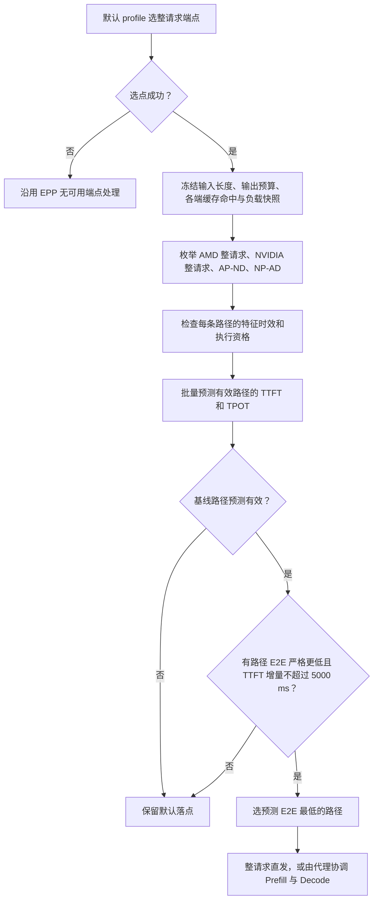
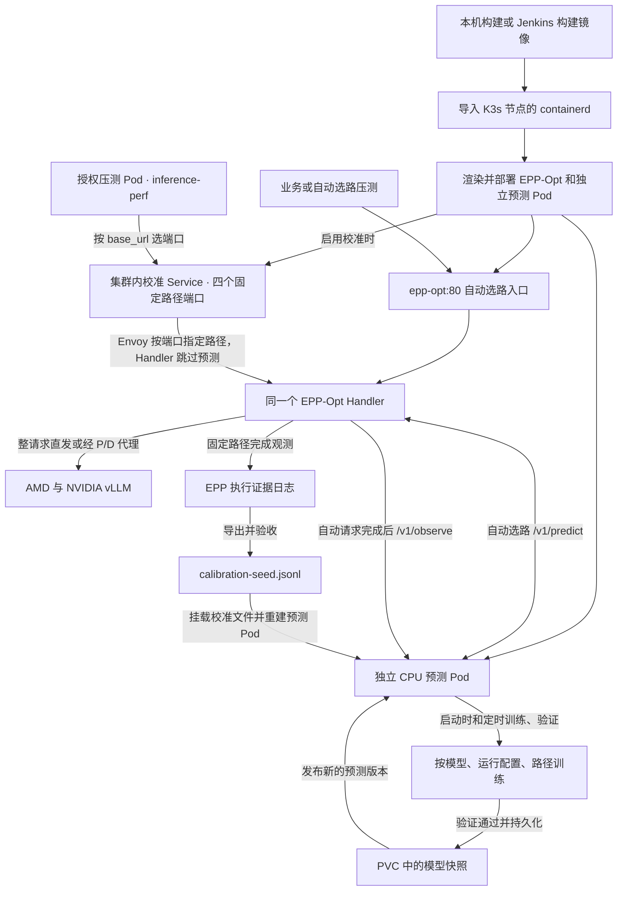

# EPP-Opt

**EPP-Opt 是 llm-d EPP 的可选调度插件实验项目。** Go 插件注册为 `e2e-aware-pd-profile-handler`，与 `disagg-profile-handler` 实现同一级 `ProfileHandler` 接口。它对 AMD、NVIDIA 上的整请求与跨厂商 P/D 路径做逐请求比较，以降低端到端完成时间（E2E）为目标，同时约束首 token 时间（TTFT）的增量。

## 1. 插件接入

部署配置可选择默认策略或 EPP-Opt。默认 profile 继续由 `prefix-cache-affinity-filter` 筛选和 `token-load-scorer` 评分，选出一个整请求端点。启用 EPP-Opt 时，Handler 使用该端点作为本次请求的**比较基准和回退落点**。优化候选来自同一个推理池中模型兼容、就绪且具备相应角色的端点，候选枚举在默认 profile 的前缀亲和筛选之前取集合。

Go Handler 在 EPP 进程内决定最终端点和执行路径。独立 CPU Pod 提供延迟预测和训练。`epp-opt:80` 接收自动选路流量，包括整请求与 P/D。固定路径校准使用同一个 EPP-Opt Deployment 提供的可选入口，见[部署与使用](#5-部署与使用)。

## 2. 逐请求决策树



默认落在 AMD 或 NVIDIA 的请求都进入评估。EPP 冻结本次请求的输入 token 数、有效输出预算，以及各候选端点的连续前缀命中 token 数和运行／等待请求数等负载数据。观测到的零命中可参与预测。缺失或过期的快照使依赖它的路径失去资格。公共输入或基线路径预测无效时保留默认落点。

| 路径 | 参与比较的端点和状态 |
| --- | --- |
| AMD 整请求 | AMD 端点执行 Prefill 和 Decode，使用该端点的前缀命中与负载。 |
| NVIDIA 整请求 | NVIDIA 端点执行 Prefill 和 Decode，使用该端点的前缀命中与负载。 |
| AP-ND | AMD Prefill → NVIDIA Decode，使用两端各自的缓存和负载状态，计入 AMD → NVIDIA 的 KV 交接。 |
| NP-AD | NVIDIA Prefill → AMD Decode，使用两端各自的缓存和负载状态，计入 NVIDIA → AMD 的 KV 交接。 |

TTFT 覆盖首 token 前的排队和计算，P/D 路径还包含 KV 交接及 Decode 等待。TPOT 是首 token 之后每个输出 token 的平均耗时。所有候选使用同一个输出预算，延迟统一换算到毫秒。

```text
预测 E2E = 预测 TTFT + max(输出预算 − 1, 0) × 预测 TPOT

候选可替换基线，当且仅当：
  候选 E2E < 默认落点 E2E
  候选 TTFT ≤ 默认落点 TTFT + 5000 ms
```

满足条件的候选按预测 E2E、预测 TTFT、稳定端点标识依次排序。候选 E2E 与默认落点持平时保留默认落点。

PR #2048 在固定 P/D 拓扑中用 `maxTTFTPenaltyMs` 比较亲和组与非亲和组各自最低的预测 TTFT。EPP-Opt 借用相对时间差的设计，将参照点定为默认 profile 选中的整请求端点。历史 A4 样本的 TTFT 从 260 ms 增至 7298 ms，增量 7038 ms，即使 E2E 更低也超出新版预算。 [PR #2048 分析](<../../docs/参考 PR llm-d-2048.md#缓存亲和的-5-秒阈值>)

### 路径执行资格

整请求直接发给选中的 vLLM 端点。P/D 路径由 EPP 提供 Prefill 和 Decode 地址，集群内 P/D 代理发起 Prefill 请求并把 KV 交接元数据传给选中的 Decode 端点，Decode 通过 NIXL 拉取 KV 后流式返回。执行资格按模型、运行配置和传输方向验证。P/D 代理对 Prefill、Decode 的地址执行 InferencePool allowlist 校验，按本次请求选中的 Decode 端点转发。渲染时用 `--verified-pd ap-nd` 或 `--verified-pd np-ad` 声明已经验证的方向。默认两个方向关闭。验证须使用对应模型和运行配置完成 P/D 推理，并核对实际端点和 NIXL 传输。 [现有部署渲染器](render-deployment.py)

## 3. 独立预测 Pod

CPU Deployment 中的预测 Pod 通过集群内 Service 接收推理估算与训练反馈。借鉴 PR #2048 的批量预测、流式观测和模型更新闭环。 [PR #2048 预测闭环](<../../docs/参考 PR llm-d-2048.md#4-预测闭环和存储>)

1. **校准冷启动。** 按模型、运行配置和路径整理实测样本，训练 TTFT 和 TPOT 回归模型。历史的两路径样本在补齐当时的双端负载、缓存与输出预算后可用于对应路径的初始化。为 AMD 与 NVIDIA 整请求及两个 P/D 方向分别补齐冷／热前缀、长度和负载覆盖。当请求没有完全相同的校准点时，在已有覆盖范围内用最多 12 个近邻进行距离加权回归。模型用 `输入 token 数 − 已命中 token 数` 表示尚需计算的输入量。覆盖不足的路径可通过 EPP-Opt 的固定路径校准补样。
2. **在线预测。** Go Handler 在一次默认限时 35 ms 的 RPC 中发送所有合格路径的特征，获取各路径的 TTFT、TPOT 和模型版本，再在 EPP 内择优。预测服务超时、不可达或基线预测无效时保留默认落点。记录 RPC 开销，并将它计入压测的客户端观测时延。
3. **请求反馈。** EPP 保留调度时的特征、选择结果和模型版本。流式请求成功完成后，异步上报请求 ID、确认的实际执行路径、从 EPP 收到请求到首个生成 delta 的实测 TTFT、E2E 和 usage 提供的实际输出 token 数。OpenAI 流式请求需要 `stream_options.include_usage: true` 或由 vLLM 强制报告 usage。用 `(实测 E2E − 实测 TTFT) / (实际输出 token 数 − 1)` 计算 TPOT，单 token 响应只提供 TTFT 标签。每条反馈只给实际执行路径提供监督标签。
4. **在线更新。** 预测 Pod 启动时读取校准文件和 PVC 中的样本、模型快照，随后默认每分钟用校准数据和最近 8192 条实测反馈尝试更新。按请求 ID 分配约 25% 的样本作验证，逐路检查 TTFT 与 TPOT 误差。验证通过且快照写入 PVC 后，预测 Pod 原子切换内存中的版本。运行中的训练或保存失败时继续使用上一有效版本。 [训练实现](predictor/service.go)

## 4. 验证口径

| 场景 | 预期决策 |
| --- | --- |
| 默认选 NVIDIA，另一条合格路径 E2E 更低且满足 TTFT 预算 | 可以改判到该路径。 |
| 热前缀或负载组合没有完全相同的校准点，且落在训练覆盖内 | 继续预测和比较。 |
| 预测 TTFT 比基线恰好多 5000 ms，且 E2E 严格更低 | 保留为可选路径。 |
| NP-AD 的 KV 交接尚未通过验证 | 排除 NP-AD，其余合格路径继续竞争。 |
| 预测超时或基线路径预测无效 | 保留默认落点。 |

后续压测使用相同流量对比默认策略与 EPP-Opt，按请求 ID 关联 EPP 决策、实际端点与流式完成事件。报告**四路径实际完成数、全流量 E2E、短请求 TTFT P95 和 SLO goodput**，并记录逐路径预测误差、RPC 开销和回退原因。P/D 执行由代理或 vLLM 记录确认，结合 NIXL 传输指标核验。

## 5. 部署与使用

### 部署、校准与模型更新流程

校准与自动选路共用一个 EPP-Opt Deployment。校准入口按需开放，采得的样本经过验收后作为预测模型的冷启动数据。 [四路压测校准设计](../../benchmark/pd/DESIGN.md)



1. **部署服务。** 构建或发布同一个 EPP-Opt 镜像，导入 EPP 和预测 Pod 可调度的 K3s 节点。渲染并部署 EPP-Opt 与预测服务。预测 Pod 可以先用已有校准文件启动，也可以从实际请求积累样本。基线预测尚不可用时，自动入口由默认 profile 选出的端点承载请求。
2. **固定路径压测。** 渲染时使用 `--calibration-namespace`，由同一个 EPP-Opt Deployment 提供四个固定路径端口。压测 Pod 用标准 inference-perf 配置选择 `server.base_url`。Handler 使用同一套模型池、端点资格检查与流式观测，跳过预测查询。目标不可用或特征失效时返回错误。
3. **导入校准并验证选路。** 将 EPP 固定路径完成日志与 NIXL 证据一起验收，导出 `calibration-seed.jsonl`。先用独立预测实例核对路径覆盖和误差，再挂载校准文件并重建预测 Pod。挂载原有 PVC 可保留模型快照和在线观测。关闭校准入口后，用独立流量打 `epp-opt:80`，核对实际分流、预测版本和收益。
4. **在线更新模型。** 自动入口持续上报符合采样条件的完成请求。预测 Pod 定时训练、校验和发布新版本，EPP 的后续预测请求直接读取已发布版本。在线更新由预测 Pod 完成，镜像构建和服务 rollout 用于发布代码或部署配置变更。

### 构建与部署命令

四路径版本渲染后的入口为 `epp-opt.llm-d-serving.svc.cluster.local:80`。

准备 `upstream.rev` 指定的 llm-d-router checkout，在本目录执行构建。镜像包含 EPP、P/D 代理与预测服务。使用 Docker 时省略第三个参数。指定第三个参数时直接生成可供 containerd 导入的 OCI 归档。

```bash
./build.sh /path/to/llm-d-router docker.io/library/epp-opt:four-path /path/to/epp-opt.oci.tar
```

镜像需要导入 EPP 和预测服务可调度节点的 K3s containerd。将 `--model` 设为推理池服务的模型名称，并用 `--runtime` 标识本次模型、GPU、vLLM 与 KV 配置组合。更新这些配置后使用新的 runtime ID。 [LLM-D 部署指南](../README.md)

```bash
workdir=$(mktemp -d)
kubectl -n llm-d-serving get deploy llm-serving-epp -o json > "$workdir/router.json"
kubectl -n llm-d-serving get cm llm-serving-envoy \
  -o 'jsonpath={.data.envoy\.yaml}' > "$workdir/envoy.yaml"
python3 render-deployment.py \
  --deployment "$workdir/router.json" --envoy "$workdir/envoy.yaml" \
  --model Qwen3-0.6B --runtime small-v1 \
  --image docker.io/library/epp-opt:four-path > "$workdir/epp-opt.json"
kubectl apply --server-side -f "$workdir/epp-opt.json"
kubectl -n llm-d-serving rollout status deploy/epp-opt-predictor
kubectl -n llm-d-serving rollout status deploy/epp-opt
```

渲染时可加 `--calibration /path/to/calibration-seed.jsonl`。渲染器用 ConfigMap 挂载文件，并在内容变化时更新预测 Pod。文件超过 1 MiB 时，将它以 `observations.jsonl` 存入已有 PVC 根目录，并改用 `--calibration-pvc <claim-name>`。更新同一 PVC 中的文件后需重启预测 Deployment。每行提供一条真实执行样本，时延单位为毫秒。

```json
{"request_id":"calibration-amd-001","features":{"model":"Qwen3-0.6B","runtime":"small-v1","route":"amd","input_tokens":2048,"output_budget":256,"prefill":{"cached_tokens":576,"running":2,"waiting":0},"decode":{"cached_tokens":576,"running":2,"waiting":0}},"output_tokens":240,"ttft_ms":300,"e2e_ms":5080}
```

整请求的两阶段状态填写同一个端点的数据。可用路径名为 `amd`、`nvidia`、`ap-nd`、`np-ad`。已有两路径 JSONL 里的 `pd` 指 AP-ND，旧记录缺少完整双端状态时应补采。校准样本的 `model` 和 `runtime` 需与部署参数一致。

预测 Service 为集群内 `epp-opt-predictor:8080`，预测训练状态写入同名 PVC。EPP 日志记录预测版本、RPC 耗时、改判端点和回退原因。

### 开启四路固定校准

在上述渲染命令中加入 `--calibration-namespace <压测命名空间>`，然后应用并等待 EPP-Opt 就绪。两个 P/D 方向各自依赖已验证的 `--verified-pd` 声明。压测 Pod 需要在指定命名空间中加上 `epp-opt-calibration-client: "true"` 标签。集群须启用 NetworkPolicy 执行，并确保其他 Ingress 策略未向这些端口授予额外访问权限。部署后分别从带标签和无标签的 Pod 测试连通性。

| 路径 | `epp-opt-calibration` Service 端口 |
| --- | ---: |
| AMD 整请求 | 18081 |
| NVIDIA 整请求 | 18082 |
| AP-ND | 18083 |
| NP-AD | 18084 |

Envoy 在普通端口清除客户端的内部校准头。在校准端口，Envoy 写入对应路径，并要求 EPP 确认该路径后才向后端转发。校准完成事件独立写入 EPP 容器日志，包含两个端点、入口请求 ID、EPP 内部 ID，以及实际延迟和冻结特征。采样和导出步骤见 [四路校准设计](../../benchmark/pd/DESIGN.md#运行和导出)。

验收后省略 `--calibration-namespace` 重新渲染，应用并等候 `deploy/epp-opt` rollout。随后删除 `service/epp-opt-calibration` 和 `networkpolicy/epp-opt-calibration`。此时可用 `--calibration` 或 `--calibration-pvc` 一并发布已验收的种子数据。

### 历史实验

历史两路径 E2E 实验版本注册名为 `epp-opt-profile-handler`，只在默认落到 AMD 时比较 AMD 整请求与 AP-ND，使用绝对 `ttftSLOSeconds: 5` 及静态 JSONL 校准。历史 9B 混合压测中，76 个预测 E2E 更低的 P/D 候选都被该绝对 TTFT 上限拦下，实际 P/D 为 **0/288**。

## 6. Jenkins 构建与镜像发布

流水线检出 LLM-Serving 源码和 `upstream.rev` 固定的 llm-d-router 提交，在临时上游源码树中接入 EPP-Opt 并执行 Go 测试，再调用现有脚本构建 `linux/amd64` 镜像。启用发布时，最后一阶段将镜像推送到 GitHub Container Registry（GHCR）。 [Jenkinsfile](Jenkinsfile) · [build.sh](build.sh)

1. 给构建 agent 添加 `epp-opt-builder` 标签。安装 Git、Bash、Python 3、tar、Go 和 Docker，并确认 agent 用户能执行 `docker info`。构建和发布需要访问同一个 Docker daemon。使用默认 Docker endpoint，或在 agent 环境中设置 `DOCKER_HOST`。Go 工具链以锁定的 llm-d-router 提交中的 `go.mod` 为准（当前为 `1.27.4`）。使用 `GOTOOLCHAIN=auto` 时，agent 需要能下载对应工具链和 Go 依赖。
2. 在 Jenkins 创建 **Pipeline** 任务。选择 **Pipeline script from SCM → Git**，仓库填自己的 LLM-Serving fork，分支填包含该 Jenkinsfile 的分支，**Script Path** 填 `llm-d/epp-opt/Jenkinsfile`。构建任务指向你控制的分支。
3. 首次在 Jenkins 运行该任务以加载参数。默认 `PUBLISH_IMAGE=false`，用于验证检出、测试和本地镜像构建。测试失败时流水线停止。
4. 准备发布时，在 Jenkins 新建 **Username with password** 凭据，ID 为 `epp-opt-ghcr`。用户名填 GitHub 账号，密码填有目标包写权限的 GitHub classic PAT（`write:packages`）。选择 **Build with Parameters**，勾选 `PUBLISH_IMAGE`，将 `IMAGE_REPOSITORY` 填为 `ghcr.io/<fork-owner>/epp-opt`，其中 owner 使用小写。
5. 发布成功后，镜像出现在目标 owner 的 GitHub Packages 下，标签为 `<源码提交前 12 位>-<Jenkins 构建号>`。如需让包显示在 fork 的仓库页面，在包设置中关联该仓库。Jenkins 归档的 `.epp-opt-ci/image.env` 包含标签、按 digest 引用的镜像地址和两个源码提交，可用于核对发布结果及后续部署。

### 第二阶段的手动部署任务

首阶段在 Jenkins 完成一次实际发布后，再增加独立的手动部署任务。任务从选定的成功构建读取 `image.env`，按 digest 拉取并导出镜像，将它导入 EPP 和预测 Pod 可调度节点的 K3s containerd，再更新 EPP、P/D 代理和预测服务所用的镜像引用，并检查两个 Deployment 的 rollout。

现有 K3s 离线导入脚本通过 SSH 校验 SHA256 并将固定的 vLLM 与 Envoy 镜像导入 containerd。第二阶段复用该流程，增加可传入 EPP-Opt 归档、校验和与目标节点的入口，再用可非交互执行的 SSH 和 sudo 配置接入 Jenkins。渲染器使用 `imagePullPolicy: Never`，因此更新 Deployment 之前应在每个目标节点核验 Deployment 将要引用的镜像名称。 [K3s 离线镜像导入脚本](../scripts/import-prebuilt-images.sh)
